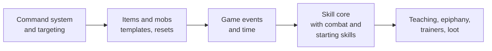

# Riftward design

Riftward is a classless telnet MUD built on a headless Bevy server. Characters are defined by the skills they learn and use, and by attributes they raise with Karma. The world is built from zone files, mostly from inside the game.

Each document below covers one area and can be read on its own. This page is the summary and the index.

**Picking the work back up?** Start with [Where we are](STATUS.md): what's built, what's next, and what's waiting on a decision.

**Terminology:** a **mob** (short for *mobile*, the traditional MUD term) is any creature the game controls: monsters, animals and townsfolk alike.

## Design goals

- **Builds emerge from play.** There are no classes. Combining skill trees (sword and fire, stealth and herbalism) is how players invent their own archetypes.
- **Learning is social.** Every skill can be taught, and the rarest only by players who have mastered them, so experienced players are worth seeking out.
- **Regular practice beats bingeing.** Skills improve through use, gain chances fade with time away, and cooldowns make spamming and botting pointless.
- **The world keeps secrets.** Hidden skills and magical Awakening unlock by epiphany when a character meets conditions nobody has written down.

## Documents

| Document | Covers | Status |
| --- | --- | --- |
| [Architecture](architecture.md) | How the server is built today, and the foundation still needed: commands, items and mobs, events, time, combat | Partly built; events and time started |
| [Skills](skills.md) | Skill trees, active and passive skills, rarity, how skills are acquired, hidden skills | Core built |
| [Skill trees](trees.md) | The shape every tree shares, the canonical tree list with a first pass at each tree's skills, what the engine needs for them, and the build order | Plan |
| [Progression](progression.md) | How skills level through use: practice, gain chance, gain cooldowns | Built |
| [Attributes, Karma and Luck](attributes.md) | The ten attributes, Karma, vitals, the ratio rule (opposed rolls), Luck and the `Dice` service | Built |
| [Magic and Awakening](magic.md) | Magic, the four traditions, and how characters Awaken | Awakening and the first spells built |
| [Items, containers and locks](items.md) | Templates, Bulk, hands and wear slots, containers and automatic placement, encumbrance, persistence, decay, unique items, locks and keys, traps | Mostly built |
| [The living world](world.md) | Mob templates, spawns and resets, breeding, wandering and crowding, doors and hidden doors, world flags and events | Mob spawns, breeding, wandering and crowding built |
| [Facts, requirements and rules](facts.md) | One store for what the game remembers (world, character, quest and mob facts), one requirement language, and rules that react to events | Designed |
| [Groups](groups.md) | Following, groups formed the ROM way, shared experience and coin, assisting, taunting a pack | Built, but taunting and group contracts |
| [Quests and the Adventurers' Guild](quests.md) | Quests as data, goals and rewards, guild contracts and metal ranks (Bone to Platinum), GM quest tools | Membership and ranks built; quest files load and the board reads them; the rest of quests designed |
| [Effects, conditions and scripting](effects.md) | How designers add skills, spells, conditions and items without code: conditions as data, one effect vocabulary, abilities, formulas, triggers, and Rhai scripting | Conditions, effects, damage types, resisting, item conditions, formulas and reactions in a fight and out of one built (steps 1 to 4); active skills through `use` next |
| [Money and shops](economy.md) | Copper, silver and gold in a purse, coins from kills, shops that sell, buy and resell, what lessons cost, Haggling and Appraisal | Built |
| [The setting](setting.md) | The world: the Agryn and the barrier, the Middle Kingdoms, the Wastes, vitae and rune magic, the Citadel, and Riftwatch's people and places | The world as it stands |
| [Riftwatch](riftwatch.md) | The starting town: map, districts, doors, where trainers go, the sewers | Rooms and doors built |
| [The Darkwood](darkwood.md) | The forest beyond the North Gate: its reaches, creatures and food chain, flora, hazards, and what it needs in code | Design; the road and the Hermit's Clearing built |
| [Races, backgrounds and creation](characters.md) | Character creation, the ten races and their skills, backgrounds as past lives, conditions | Built |
| [Hosting](hosting.md) | Running Riftward for others to play: from your own machine through playit.gg, or on a small server with systemd; backups and updates | Guide |

## What exists today

- Telnet server, one command handled per player per tick, in the order typed.
- Accounts and characters in SQLite, with roles: player, builder, GM (game master: puppeting and live events) and admin.
- Zone files in `assets/zones`, hot-reloaded, plus in-game building: `dig`, `desc`, `link`, `zone create`, and more.
- Communication: `say` (or `'`), `emote` (`em`, or `:`: `:waves` shows "Grok waves."), `whisper`, `yell` (zone), `gossip` (global).
- Riftwatch, the starting town, the sewers beneath it, and the edge of the Darkwood beyond its North Gate ([map](riftwatch.md#map)).
- Items: templates with Bulk and tags, hands, wear slots, weapons, armour and shields, containers (backpacks, pouches, keyrings, pockets, chests) with automatic placement, encumbrance, keys, and real items that survive restarts.
- Mobs: templates and spawns in zone files, timed and after-death resets that count their mobs wherever they wander, breeding populations that grow toward a cap and reseed after being wiped out, crowding that pushes them outward and, packed in, through closed doors (the rats gnaw through the grates), wandering within rooms, a zone or anywhere, equipment that they fight with and drop in their corpses, technique skills used by chance, and the builder `mob`, `spawn`, `summon` and `purge` commands. Item spawns keep rooms stocked and top up containers, and unique items are never made twice. Riftwatch has guards, a stray dog, the contract clerk, the herbalist and the drill sergeant, a signpost, practice swords and a stocked chest in the guild cellar; the sewers have rats.
- Game time: a day and night every 3 real hours, dawn and dusk announced outdoors, `time`, and a one-second heartbeat. Movement goes through shared game events, so arrivals say where people came from.
- Doors and trapdoors: `open`, `close`, `lock`, `unlock`, `bash`, by direction or name, and the builder `door` command.
- A command registry with generated `help`, permission-hidden commands, and target resolution (`2.goblin`, `all.coin`, `me`).
- Per-character aliases.
- Character creation: race, starting Karma, background (11 past lives, gated by conditions) and a description, with `back` at every step. Races and backgrounds are data files.
- Trainers: `learn` from mobs who teach, entry skills and first spells only. Skills are free; spells cost money, but for each tradition's starter. The drill sergeant teaches every weapon's basics; a teacher for each magic tradition Awakens those with latent talent. Higher skills are discovered, very rarely, by using their tree, and a tough fight makes gains and discoveries likelier.
- Attributes, starting Karma, `raise` (a point costs the rating it reaches), `score`, `describe`, and the Luck-aware `Dice` service.
- Unlocking skills with Karma: `karma` lists the priced skills in your trees, and `karma <skill>` learns one whose requirements you meet.
- Skills: trees as data, use-based progression with practice and cooldowns, active skills (`use`: made of effects in data, like First Aid, or with their own command, like `pick` for Lockpicking) and passive ones (Endurance), starting skills, uncapped levels with a soft cap set by character level, `skills`.
- Experience and character level: earned by victories (worth the risk overcome, nothing for easy ones) and discoveries; every level costs the same 1,000 and brings 5 Karma. Contests are opposed rolls by the ratio rule, steep (k = 3), with a margin.
- World events: saved world flags, and events in zone files that react to mobs entering zones and dying. A rat breakout raises the Rat King, whose aura toughens every sewer rat until he dies.
- The sewers' ecology: rats in the east, slimes in the west (oozes that split when struck hard, rubbery grey slimes, and the Slime Lord in the Old Cistern, shedding oozes and mending as it fights), meeting at a border; cockroaches, a venomous snake and a rat swarm. Slimes are formless: no corpse, just the jelly they were.
- The west woods: fifteen rooms of the Darkwood off the Bend, rabbits and deer that startle and bolt, foxes, adders, boars that enrage, giant frogs, a badger, a stag that stands and fights, and the hunter's camp.
- Traits: what a creature or race is, for good (skittish prey, inanimate dummies, the elves' Fey Mind), the same shape as conditions but kept through cures and death, from mob templates and races.
- Effects: one vocabulary for spells and techniques, with amounts as formulas in data (`"roll(2, 5) + floor(power / 3)"`), reactions that conditions and passive skills set off in a fight (thorns) and out of one (entering a room, resting, a condition running out, every so often), one resolver for every blow, technique and spell, each naming what resists it (Grapple is your grip against their Strength), and passive skills that help resist by tag: the elves' racial Fey Mind resists sleep and charm. `use` finds spells too, though spells are cast.
- Techniques and conditions: every weapon tree's journeyman techniques (Kick, Grapple, Lunge, Riposte, Backstab, Open Vein, Cleave, Hew, Stagger, Crush, Sweep, Guard), staggers, falls, bleeding, holds and guards, and passive bonuses (Toughness, Endurance, the Adept's Killing Hands and Quickened Reflexes).
- Combat: 3-second rounds in initiative order, auto-attacks chosen by the player, attack skills (Brawling, Swordplay with a blade, beasts' bites), Dodge, aggressive mobs with pack limits, auras, resting (faster recovery, but dangerous), corpses, death and respawn at the shrine, `kill` and `flee`. Action commands queue, one per round.
- Spells: `cast`, `spells`, Drain resisted by Willpower, lasting effects that wear off in time whether fighting or not (`affects` shows what's on you and for how long), and the first two spells of each casting tradition (Mend, Bless, Spark, Ward, Beast Speech, Spirit Grasp) plus Hermetic's Kindle Blade, learned from the tradition's teacher and cast through its school, in a fight or out. Mobs cast them too.
- Item quality and rarity: each item is crude to masterwork (withered to perfect for things that grow), changing its value, damage and armour; each template common to legendary, colouring its name and multiplying its value. Loot rolls quality with Luck, and gathering by how well it went.
- Players and mobs are the same kind of character: commands work for either, mobs can be of the peoples (`race`), wandering mobs walk with the same command as players, and GMs can `puppet` (or `possess`) a mob to play it, hearing what it hears.
- Conditions as data: twenty-one (staggered to strengthened), made of modifiers, with their own wording and hints others see ("a bright shimmer surrounds Grok"); any technique, spell or item can put on or grant any of them, and those lasting in time are saved with players. Damage types as data (`physical`, the elements, the energies, light, shadow, force, poison), with armour that stops only what it says and conditions that resist types or grant immunity to tags. Conditions on single items, saved with them: Kindle Blade sets a weapon alight for its next ten blows, and `examine` shows what's on a thing.
- Groups: `follow` someone to go where they go, and the leader takes followers in with `group <name>` (the ROM way); `group` lists the members' health and stamina, `gtell` talks to them anywhere. A fight is rated as a whole, like an encounter: each side (a player alone, or a group) against every foe who fights it or waits its turn, never getting easier as they fall, and each kill pays its share of what the whole fight is worth, to every member in the room. Members split a foe's coins, and roll its loot with their average Luck; with `autoassist` (on by default) they join each other's fights. `nofollow` turns followers away.
- The Adventurers' Guild: `join guild` at Marin Harrow's counter for a Bone tag; rank by merit, Bone to Platinum (by itself through Iron, by trial from Silver), shown in `who` and by `GuildRank` requirements only while the tag is worn. Expulsion takes the tag but not the rank, and `reinstate` buys it back; GMs run promotions, merit and expulsions with `guild`.
- Money and shops: a copper, silver and gold purse (`give 5 silver wren`), coins from kills and from mobs' pockets (`steal`), and shopkeepers (the herbalist, the provisioner, the tinker) with `list`, `buy`, `sell` and `value`, who resell what they buy. Spell lessons cost money, except each tradition's starter spell. Haggling strikes a deal with each shopkeeper that moves prices your way, and `appraise` tells what things are worth.
- Stealth: `hide`, `sneak` and `search`; unseen characters aren't listed, targeted or announced, and what they do quietly is seen only by those who noticed them, aggressive mobs ignore what they haven't noticed, acting openly reveals, and a Backstab from hiding can't be avoided.
- Tracking, Climbing and Swimming: rooms remember who walked through, read with `track`; exits that need a climb or a swim, tried by anyone, practised by the trained.
- Gathering: `forage` (Foraging) and `gather` (Herbalism), from what each room's environment yields, depleting and growing back; mob loot tables, rolled with the killer's Luck.
- Healing: First Aid with bandages (`bandage`, in a fight or out), food and drink that speed recovery, and healing draughts (`eat`, `drink`).
- Vitals: current health and stamina that recover over time (offline too), and a customisable status prompt, `<7/10hp 9/9st>`.

## Roadmap

The engine foundation comes before the skill system, because skills need things to act on: targets, items, events and time. See [Architecture](architecture.md#proposed-build-order) for detail.

## Planned features

Designed, waiting on other work:

| Feature | Waits on | Details |
| --- | --- | --- |
| Scripting for behaviour data can't express; language to decide (Steel, Rhai or Lua) | The effect system, mobs and game events | [Architecture](architecture.md#scripting) |
| Bots: programs that play mobs through puppeting, reading GMCP; later several mobs at once, leashed movement and shops within bounds | GMCP, a bot role | [Architecture](architecture.md#bots), [#14](https://github.com/Foxworks-Studios/riftward/issues/14) |
| Quests and guild contracts, with guild ranks that gate trainers and rooms | Mobs, game events, combat | [Quests](quests.md) |
| Dialogue: conversation trees for mobs, likely [Yarn Spinner](https://www.yarnspinner.dev)'s Rust port, keeping the core independent of Bevy | Mobs | To design |
| Mob behaviour: data-driven first (wander, flee, assist, aggressive), behaviour trees ([bonsai-bt](https://github.com/Sollimann/bonsai)) only for mobs that need more | Mobs, combat | To design |

## Decisions so far

| Area | Decision |
| --- | --- |
| Classes | None. Skill trees, with hybrid skills across trees |
| Learning | Every skill can be taught. Students need the skill's requirements, not its tree. Trainers teach only entry skills; the rest is discovered through use (very rarely), taught by players, found as loot, or taught by remote trainers as quest rewards. Loot-only skills are taught only by masters |
| Armour | Takes damage off every hit, even to nothing, and costs dodging; shields block instead. Piercing (`Pierce(n)`) and Crush answer it |
| Tough fights | Being outmatched (by the ratio rule) multiplies the chance of skill gains and discoveries, up to double |
| Progression | Use-based gains; practice builds with use and fades with time; a level-scaled cooldown per gain |
| Skill kinds | Active (invoked with `use <skill> <target>`) and passive (progress on trigger events, usually outcomes) |
| Death | A player's corpse keeps everything they carried, where they fell, for 30 minutes (surviving restarts); they wake at the Wayside Shrine, hurt. No PvP yet |
| Combat | Made entirely of skills. Everyone starts with a basic attack skill; mobs fight with skills too. Each round a fighter's auto-attack fires on its own: the most basic attack they know, unless they've chosen another. Other skills are used by command |
| Starting skills | Granted by race and background, plus universal skills (Brawling, Dodge, Endurance). Racial abilities are skills that require the race. Backgrounds are past lives: everyday skills and tools, never fighting or magic, which everyone learns from trainers. Backgrounds can require attributes or a race |
| Races | Ten: Dwarf, Elf, Halfling, Human, Kitsune, Lizardfolk, Ork, Sprite, Stoneborn, Troll. Attribute shifts that total +3 for every race; humans get 12 Karma instead |
| Hidden skills | Learned only by epiphany when stringent conditions are met (skills, titles, the right place at the right moment), with an optional trigger |
| Attributes | Ten, uncapped. Base 3 (Luck 1, Magic 0), shifted by race, with 20 Karma to spend, which can go on Magic as latent talent. A point costs the rating it reaches. Karma also unlocks priced skills in a character's trees |
| Formulas | Contests are opposed rolls that compare ratios, never differences, because ratings are uncapped; steep (k = 3), always rolled, with a margin |
| Progression | Skills level by use, uncapped but ever slower, with a soft cap of 10 + 2 × character level. Character level comes from experience (victories by risk, discoveries, quests), 1,000 a level, and brings 5 Karma a level |
| Luck | Each point makes every roll a percent better: chances likelier, amounts bigger, contest ratings stronger, picks from tables further toward the best. No cap. Group loot uses the group's average Luck |
| Magic | Latent until the character knows a tradition's foundation skill; knowing one is being Awakened. Four traditions, each with a teacher in the world who Awakens anyone with Magic 1 (bought with Karma). Everyone starts mundane |
| Spells | Their own category, not skills: known, never levelled, cast through a school (a skill) whose level plus Magic is their power. They don't add to character level. Adepts have powers (skills) instead. Everything else, weapon techniques included, is a skill |
| Commands | Players can define aliases; aliases can't shadow built-in commands |
| Persistence | An item becomes real (saved) the moment a player touches it, and then survives restarts wherever it is. Untouched spawns and mobs reset |
| Time | A day and night every 3 real hours. No global tick: a one-second heartbeat, and systems that work from elapsed time and timestamps |
| Spawns | One model: each spawn resets on its own timer (`every`, or `AfterDeath` for bosses) and either keeps a count or breeds, reseeding a week after being wiped out. Mobs count toward their spawn wherever they wander |
| World events | Data-driven triggers and actions over world flags, counters, spawn counts and game events |
| Item decay | Dropped items decay (litter); perishables rot even when carried; unique items never decay |
| Quests | Data in `assets/quests/`. Never grant skill levels or Karma: they pay in coin, items, flags, titles and guild merit |
| Adventurers' Guild | Optional. Guild rank (Bone to Platinum) is separate from character power, rises only through guild contracts, never drops, and gates some trainers, contracts, rooms and vendors |
| Locks | Doors and containers share one lock: open, closed or locked, with keys, `pick` and `bash` (which only forces it open). Locks reset with their zone; hidden doors are found per character |

## Biggest open questions

Each document lists its own open questions. These are the ones that shape the most:

1. **What stops one character learning every tree?** A total cap on skill levels, skill slots, or rising costs. See [Skills](skills.md#open-questions).
2. **What exactly does each background grant,** and what does each tree hold? See [Races and backgrounds](characters.md#open-questions).
