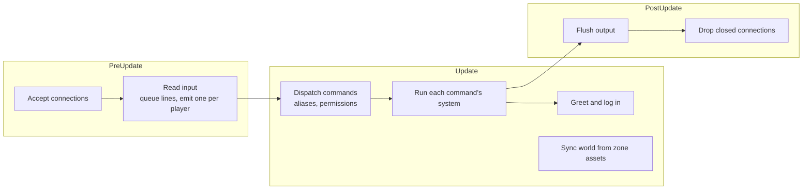

# Architecture

[Design summary](README.md) · Status: the server below is built; the [foundation](#foundation-still-needed) is proposed

The server is a headless Bevy app: no window or renderer, just the ECS, the app loop, logging and asset loading. Players connect over telnet. Designed content (the world, later skills) lives in hot-reloaded RON files; anything that changes during play lives in SQLite.

## The server today

### Running it

```sh
cargo run                       # listens on 0.0.0.0:4000, database mud.db
MUD_ADDR=127.0.0.1:5000 cargo run
MUD_DB=/tmp/test.db cargo run
nc localhost 4000               # or telnet, TinTin++, Mudlet
```

`cargo run` matters: it is how Bevy finds the project's `assets/` folder.

### Modules

| Module | Responsibility |
| --- | --- |
| `main.rs` | Builds the app: a 30 Hz loop, logging, asset loading with file watching, and the plugins below |
| `net.rs` | TCP listener; one entity per connection with a `Connection` component; queues each client's lines and hands out one per tick as a `PlayerInput` message; flushes output at the end of the frame, marking prompts for clients that want it |
| `telnet.rs` | The telnet protocol: a parser that separates commands from text, and the options negotiated (echo for passwords, end-of-record for prompts) |
| `login.rs` | Login state machine: account, password (hidden with telnet echo control), new accounts, character choice, and character creation (race, Karma, background, description); `quit` in the game comes back to the character menu, on a fresh entity, and `quit` there disconnects |
| `command.rs` | The command system: `CommandSpec` registry, the dispatcher (alias expansion, permission hiding, unknown commands), generated `help`, and prompts |
| `commands/` | Player commands, one system each: `movement` (look, go, directions), `communication` (say, emote, whisper, yell, gossip, who), `character` (score, raise, alias, unalias, quit) |
| `build.rs` | Builder and admin commands, registered with a permission |
| `targeting.rs` | `Keywords` and `Target`: resolving `goblin`, `2.goblin`, `all.coin`, `me` |
| `output.rs` | Characters and what they're told: the `Characters` query and `Actor` (players and mobs alike), `Outgoing`, the `Outbox` and `flush_outbox`, which delivers it to connections and puppeteers, target candidate lists |
| `puppet.rs` | Puppeting: `puppet` (`possess`) and `release`, and letting go when the puppet or puppeteer goes |
| `world.rs` | Zone assets (rooms, doors, item and mob templates, spawns), room entities, the `RoomIndex`, and `sync_world`, which applies zone changes live |
| `items.rs` | Item entities, Bulk and placement rules, persistence, template grants and item conditions (loading, saving, expiring, passing to the holder), and the item commands |
| `mobs.rs` | Mob entities, wandering and crowding, `summon` and `purge` |
| `spawns.rs` | Spawns for mobs and items: timers, breeding, counting by origin, container contents, unique items |
| `events.rs` | `GameEvent`, the shared vocabulary of things that happen, and the room announcements made from them |
| `time.rs` | The game clock, parts of the day, `time`, and the one-second heartbeat |
| `combat/` | Combat: the round, death and respawn and the commands (`mod.rs`), attacks, techniques and ripostes (`strike.rs`), casting spells and mobs' choice of them (`casting.rs`), active skills made of effects, and `steal`, a shortcut to Pickpocketing (`abilities.rs`), resolving any blow, technique or spell, from the contest to what it does (`resolve.rs`), carrying out effects and the armour and resistances damage goes through (`effects.rs`), conditions and traits as data and what they do (`states.rs`, from `assets/conditions/` and `assets/traits/`), reactions set off by game events, out of the round (`triggers.rs`), allies answering a call for help (`help.rs`), mobs an effect brings into being (`spawning.rs`), and those an effect makes run (`fleeing.rs`) |
| `world_events.rs` | World events from zone files (a `when` requirement, and actions), moving old world flags into facts, and the admin `worldflag` |
| `skills.rs` | Skill trees (`.skill.ron` assets), each character's `Skills`, progression, `Practice` for commands that use skills, passive triggers, `skills`, `use` and `grantskill` |
| `vitals.rs` | Current health and stamina for players and mobs alike, their maximums, recovery, saving them, the status prompt and `prompt`, and the admin `setvitals` |
| `healing.rs` | `eat` and `drink` for consumables, and `bandage`, a shortcut for `use first aid` |
| `gathering.rs` | Active skills aimed at the room that `Find` (`roomwork`; `forage` and `gather` are shortcuts), from a room's finds, and how finds deplete and grow back |
| `tracking.rs` | Tracks left in rooms by whoever walks through, and active skills that read them (`trackwork`; `track` is a shortcut to Tracking) |
| `groups.rs` | Following and groups: `follow`, `nofollow`, `group`, `gtell`, `disband`, `autoassist`; followers walking after whoever they follow (a tick later, so they see them go), and groups tidying up when someone logs off. What a group shares in a fight is in `combat` |
| `facts.rs` | The fact store: what the game remembers about its story, by owner (the world, a character, a character's quest, a mob template) and key, with values, lapsing, and saving as they change, and the GMs' `facts world\|<player>` ([Facts](facts.md)) |
| `guild.rs` | The Adventurers' Guild: membership (`character_guild`), metal ranks and merit from `assets/guild.ron`, rank tags and `ShownRank` (what `GuildRank` conditions and `who` see), `join guild`, `guild`, `reinstate`, and the GMs' `guild promote|merit|expel|reinstate` |
| `stealth.rs` | Hiding, sneaking and noticing: `hide` (a shortcut to Stealth, data whose hiding rules are in `combat/abilities.rs`), `sneak`, `search`, who sees whom (the `hidden` condition and who has seen through it), and revealing |
| `money.rs` | The purse, coins and how amounts read and are written, giving coins, the admin `setcoins` |
| `shops.rs` | Shopkeepers: `list`, `buy`, `sell`, `value`, prices and resale |
| `trade.rs` | Haggling (deals with shopkeepers, and the prices they set), and active skills aimed at an item (`itemwork`; `appraise` is a shortcut to Appraisal) |
| `formula.rs` | Formulas: amounts in data (`"roll(2, 5) + floor(power / 3)"`), parsed at load and worked out through `Dice` with their inputs |
| `effects.rs` | The one effect vocabulary spells and techniques share (`Damage`, `Heal`, `Apply`, `Remove`, `Cure`, …), whom each is on, how long conditions last, and what fits where |
| `spells.rs` | Spell books (`.spells.ron` assets), each character's `Spells`, power and Drain, choosing a spell's target, `spells` and `cast` |
| `db.rs` | SQLite: accounts, characters, roles, aliases, attributes, skills, spells, character and item conditions, real items, spawn timers |
| `aliases.rs` | Per-character aliases |
| `attributes.rs` | Attributes, Karma costs, `score` and `raise` |
| `characters.rs` | Races and backgrounds, loaded from `assets/races.ron` and `assets/backgrounds.ron`, and the creation menus |
| `requirements.rs` | The shared requirement language, what every `requires:` holds (`Stat`, `Race`, `Skill`, `GuildRank`, `Has`, `HasItem`, `InRoom`, `InZone`, `Fact`, `Flag`, `WorldFlag`, `Event`, `All`, `Any`, `Not`), and world events' and gated spawns' `when:`, tested against a `Subject`: someone if anyone, the facts, the zone, and what just happened. `Surroundings` gathers what a command knows of someone (room, what they carry, conditions, rank shown). Not status conditions, which are `combat`'s |
| `dice.rs` | The `Dice` resource, the only source of randomness |

### One tick



- **One line per player per tick** keeps each player's commands in the order typed, even when different systems handle them, and limits anyone to 30 commands a second.
- **Output is queued** on each `Connection` during the frame and written once at the end.
- **The connection owns the prompt.** In game, each batch of output ends with exactly one `> `, text arriving while the prompt is showing starts on a fresh line, and an empty Enter gets a new prompt. Commands and notifications never write prompts themselves.

### Data

| Kind | Where | Reloads |
| --- | --- | --- |
| World | `assets/zones/<zone>.zone.ron`, one file per zone; builder commands write back to them | Live, on file change |
| Accounts, characters, roles | `accounts`, `characters` tables | n/a |
| Aliases | `character_aliases` table | n/a |
| Attributes | `character_attributes` table | n/a |

Tables are created with `CREATE TABLE IF NOT EXISTS`. The next change to an existing table needs numbered migrations (`PRAGMA user_version`).

## Foundation still needed

The skill design depends on things the server doesn't have: targets, items, events and time. These pieces come first.

### Command system and targeting (built)

Each command is registered with a `CommandSpec` (name, short forms, category, permission, usage, summary) and its own Bevy system, which receives an `Invocation` and asks for exactly the resources it needs:

```rust
app.add_command(
    CommandSpec::new("whisper", Category::Communication)
        .usage("whisper <player> <text>")
        .summary("speak privately to someone in the room"),
    communication::whisper,
);
```

- **One dispatcher** expands aliases, hides commands a player lacks permission for (they get the same "Huh?" as a typo), and queues the command's system. The prompt is sent after the command's output, so handlers never send it.
- **`help`** is generated from the registry, grouped by category and filtered by role; `help <command>` shows usage.
- **Targets** are resolved by `Target::parse` and `find_one` / `find_all` over candidates with `Keywords`: a word matches the start of any keyword, `2.x` picks the second match, `all.x` every match, and `me` the player. Others are preferred; the player is the fallback when only they match. Today the candidates are players; items and mobs join when they exist.

### Things in the world

Items and mobs are entities made from templates in zone files. Items have an `ItemLocation` (a room, hands, a wear slot, or inside another item).

**Players and mobs are the same kind of thing: characters.** Both have `InRoom`, attributes, skills, vitals, conditions, spells and gear, and the same rules apply to both. A player has a `Player` (their saved character and account) and a connection; a mob has a `Mob` (its template) and can have a race, as a player does. Commands work for either: `Characters` reads both, and `Actor` is whoever runs a command, with `character_id: None` for a mob, so anything that saves (skills, money, items, location) skips it, since mobs aren't saved. Output goes into the `Outbox`, never straight to a connection, and `flush_outbox` delivers it once a tick to players, and to whoever is puppeting a mob, capitalising each line's first letter so a mob's name reads right at the start. Mob behaviour issues the same commands a player would: a wandering mob walks with `go`. Items, containers, locks, persistence and decay are in [Items, containers and locks](items.md); mob templates, spawns, resets, wandering and doors in [The living world](world.md). Builders edit templates with `item` and `mob`, and spawns with `spawn`.

### Game events

Started. One vocabulary of game events, the `GameEvent` message in `events.rs`, written by whichever system makes something happen. Passive-skill triggers, hidden-skill triggers, quests, world events and easter-egg flags all listen to the same events, so new content adds events, not special cases.

| Event | Written by | Heard by |
| --- | --- | --- |
| `Left`, `Entered` (with `Way::Walked(direction)` or `Way::Teleported`) | Walking, `goto`, wandering mobs | The room announcements: "A stray dog leaves east.", "Gandalf arrives from the west." |
| `PhaseChanged(phase)` | The game clock | Announcements to everyone outdoors |

More arrive as their systems do: `ItemPickedUp`, `DoorOpened`, `Attacked`, `DodgeSucceeded`, `ManaSpent`, `DamageTaken`, `Died`.

### Time

Started.

- **The game clock** runs eight times faster than real time: a full day and night every **3 real hours**, a game hour every 7½ real minutes. It's worked out from the real time, so it needs no saving and a restart doesn't move it.
- **Parts of the day:** dawn from 5, day from 7, dusk from 19, night from 21. Each begins with a message to everyone outdoors; rooms flagged `indoors` (the sewers, the guildhall, the keep's halls) don't see it. `time` shows the hour, read from the sky or guessed indoors.
- **One heartbeat, once a second,** for systems that don't need every frame: spawns, wandering and the clock today; regeneration and cooldowns later. Heartbeat systems work from elapsed time and timestamps, never by counting beats, so the rate is a performance setting rather than a game rule, and a stalled server doesn't change the game. There's no old-style global tick to wait for.
- **Recovery** of health and stamina runs on the heartbeat (see [Vitals](attributes.md#vitals)).
- **Still to come:** combat rounds (2-3 seconds, with combat), and actions that take time to finish (lessons, rituals, casting).
- **Open:** a calendar (days, months, seasons) for [the setting](setting.md), and whether night changes anything beyond the messages, such as needing light outdoors.

### Combat

Built (`src/combat/`). The round loop, initiative, damage, death and respawn: infrastructure with no actions of its own. Every action in combat is a skill, starting with the basic attack every character has (see [Skill kinds](skills.md#skill-kinds)). Every roll goes through `Dice`, and every contest follows the [ratio rule](attributes.md#the-ratio-rule).

- **Rounds** every 3 seconds. Everyone fighting acts once, in order of initiative (Reaction + Intuition, plus a d6 with Luck).
- **Actions and the queue.** Commands marked as actions (`kill`, `flee`, `use`, `pick`, `bash`, future skills) take a round: at most one per round, and any typed sooner wait in the player's `ActionQueue` (up to 10; `stop` clears it). In a fight, a queued action takes the player's turn instead of their auto-attack. Everything else (looking, talking, inventory) happens at once.
- **Auto-attack.** With nothing queued, a fighter makes their auto-attack: an attack chosen with `autoattack <skill>` if they can make it, otherwise the weapon in their hand, otherwise Brawling, everyone's basic attack (`autoattack default` goes back to that).
- **Weapons** carry their damage (a short sword 2–5) and name their skill (Swordplay). Trained, a fighter attacks with that skill, and their skill shows in how hard their blows land (below); untrained, they swing it with only their Brawling to guide them, still doing the weapon's damage, and learn nothing of the weapon by it. Weapon skills (Swordplay, Knife Fighting, Axe Fighting, Hammer Fighting, Staff Fighting) have no damage of their own; Brawling's fists do 1–3.
- **Techniques and conditions:** a technique, used through the queue (`use cleave`), replaces the auto-attack for a turn; openers can start a fight. Techniques leave conditions (staggered, down, bleeding, held, guarding, exposed, or any other with `Apply`) that count down in the fighter's own turns; conditions are data, see [Conditions, as built](effects.md#conditions-as-built). Passive skills add to stats (Toughness, Endurance, Quickened Reflexes) and can counter a dodge (Riposte). See [Step 1, as built](trees.md#step-1-as-built). The combat code is in `src/combat/`: the round in `mod.rs`, attacks in `strike.rs`, conditions in `states.rs`.
- **Resting** (`rest`) recovers three times as fast, and nothing recovers in a fight. A resting character is caught off guard: attacks against them use half their defence, and their first turn goes on getting up.
- **Auras:** a mob with an aura skill makes certain mobs in its zone fight better while it lives (attack, defence and armour, which takes points off each hit). The Rat King's makes the sewer rats tougher.
- **Packs:** a spawn's `pack` caps how many of its aggressive mobs gang up on one player.
- **An attack** pits the skill's effectiveness (level + its attribute) against the defender's Reaction + Dodge, less their armour's penalty, plus a shield's block, by opposed roll (see [the ratio rule](attributes.md#the-ratio-rule)), with both sides' Luck. A hit does the weapon's (or attack's) damage plus Strength / 2 plus passive bonuses, times the **blow**, less the defender's armour (to as little as nothing; see [Armour](trees.md#armour)), and the attacker is told how hurt the target looks. Every attack a player makes practises it; every dodge practises Dodge.
- **Blows:** how decisively the attack won (the opposed roll's margin) sets how hard it lands: under 1.15 a **glancing** blow (half damage), under 1.6 **solid** (full), under 2.5 **strong** (×1.5), beyond that **crushing** (×2, a critical hit). Skill shows in damage this way for every attack, unarmed included: twice the defender's match hits 89% of the time and about 50% harder on average.
- **How a hit reads,** as in DikuMUD: a word for the share of the target's most health it took, from "scratches" and "grazes" through "wounds", "mauls", "decimates", "devastates" and "maims" to "MUTILATES", "EVISCERATES" and "MASSACRES", filled into the attack's own text ("Your slash decimates the rat."). The same 5 points graze a veteran and massacre a rat. A crushing blow ends with "!". The damage number follows in brackets, unless the player has turned them off with `numbers off`.
- **Starting and ending fights:** `kill <mob>` (players can't fight each other yet). The target fights back. A fight ends when either side dies, leaves (`flee`: a random open exit, 60% before Luck, 2 stamina), or logs out. Walking away isn't possible mid-fight.
- **Mobs fight by the same rules,** with attributes, skills, an attack and optionally a base health from their templates, and recover between fights like players. `aggressive: true` mobs attack players in their room, typing `kill` as a player would (just before each round, only players they've noticed, within their spawn's `pack`); the rest only fight back. Mobs in a fight don't wander.
- **Mobs use their combat skills** as players do: each turn, with their template's `tactics` chance (25% by default), a technique skill they know and can use right then, picked at random, takes the place of their auto-attack. They never pick openers.
- **A mob's death** leaves a corpse that rots in 5 minutes, and counts for its spawn like any death, so `AfterDeath` timers and breeding reseeds now matter.
- **Leaving a fight is fatal.** `quit` refuses while a player is in a fight that can hurt them; one who disconnects anyway is cut down as they go ("tries to slip away from the fight, and is cut down!"), and dies like anyone else, so logging out is never an escape. Hacking at a training dummy, or anything else inanimate, with nothing attacking them, isn't such a fight (`combat::in_danger`).
- **A player's death** leaves a real corpse where they fell, holding everything they carried and wore; it survives restarts and rots in 30 minutes, spilling what's left on the ground. They wake at the Wayside Shrine with a quarter of their health and stamina.
- **Not yet:** expert and master techniques (Disarm, Whirlwind and the rest), smarter mob tactics than a chance per turn, a death penalty beyond the walk back, PvP, and grouping. Tuning: see [the rat problem](riftwatch.md#the-rat-problem).

## Planned features

Features that are designed but wait on other work.

### Game masters and puppeting

*Built,* for GMs and admins (`src/puppet.rs`); see [Roles](#roles). `puppet <mob>` (or `possess`) takes over a mob in the room; `release` lets go.

Admins, and a new **GM (game master) role**, can **puppet** any mob: take it over and play it themselves until they release it. A GM can voice the goblin king during a raid, have a town guard question a suspicious player, or walk the dragon out of its lair for an event.

```
> puppet king
You take control of the goblin king.
[as the goblin king] > yell Who dares enter my halls?
[as the goblin king] > release
You release the goblin king and return to yourself.
```

- **Commands run as the mob.** While puppeting, the GM's commands act through the mob: it moves, speaks, fights and uses its skills under its own name, with its own attributes, skills and inventory. The GM sees everything the mob would see. The prompt shows who they're playing, so it can't be forgotten.
- **The mob's own behaviour pauses.** It stops wandering and acting on its own, and resumes when released.
- **The GM's own character stays put,** idle where it was left. Other players can't tell anyone is puppeting; to them it's just the mob.
- **Release** with `release`, or automatically when the mob dies or the GM disconnects. The GM returns to their own character.
- **Limits:** only mobs, never another player's character; one puppeteer per mob at a time.
- **Every puppeting session is logged** (who, which mob, when, and what they did), so the power is accountable.
- **How it fits the code:** a `Puppeting(mob)` component on the GM makes the command dispatcher send each `Invocation` on behalf of the mob (all but `release` and `quit`), with the GM's permissions, and `PuppetedBy` on the mob routes what it's told back to them. While puppeting, the GM hears nothing of their own body. The puppet gets an `ActionQueue`, so in a fight it acts on what the GM queues, and its own choices (wandering, aggression, techniques and spells by chance) stop. The prompt shows whose vitals it is: `[the town guard] <11/11hp 9/9st>`. Starting, stopping and every command typed through a puppet are logged.

### Bots

*Planned* ([#14](https://github.com/Foxworks-Studios/riftward/issues/14)). A **bot** is a program that plays a mob the way a GM does: it connects over telnet like any client, puppets a mob, reads what happens around it as GMCP rather than parsing prose, and answers with ordinary commands. The first gives the Riftwatch herbalist a voice: she greets customers, answers questions about her wares and thanks them for a sale, while the shop itself keeps running without her.

- **GMCP first** ([#15](https://github.com/Foxworks-Studios/riftward/issues/15), [#16](https://github.com/Foxworks-Studios/riftward/issues/16)). Telnet option 201 carries JSON messages beside the text, and Mudlet players get it too (health bars, scripts). Messages are built in one place from `GameEvent`s (speech, comings and goings, sales), not from each command, and routed like text, so what a puppet hears reaches its puppeteer. Standard package names (`Char.Vitals`, `Comm.Channel.Text`, `Room.Info`) where they exist; clients choose packages with `Core.Supports.Set`.
- **A bot role** ([#17](https://github.com/Foxworks-Studios/riftward/issues/17)) whose only permission is Puppet, and only for mobs whose template allows bots. Its own body is out of the game through a marker of its own (never `Hidden` with a huge stealth): unseen, not in `who`, no entering or leaving lines, and it can do nothing but `puppet`, `release` and `quit`.
- **GMs outrank bots:** a GM can take a mob from a bot, never the other way. A bot that disconnects leaves the mob to its own behaviour, as any puppeteer does.
- **Bots are untrusted clients.** Everything a bot does goes through the same commands and rules as a player. Any language model lives in the bot, never in the server.
- **Built to grow.** Every GMCP message sent through a puppet names the puppet, and the template's `bot` setting is meant to become a set of capabilities, so what comes later needs no protocol change:
  - **Several mobs per bot:** `Puppeting` becomes a set, and the bot directs each command at one puppet (`as <puppet> <command>`), reading only GMCP. One program could play a whole town's cast.
  - **Capabilities per template,** speech only by default, e.g. `bot: (speak: true, move: Leash(...), trade: (price_range: (0.8, 1.2)))`. The builder decides what each mob's bot may do.
  - **Movement on a leash:** a bot moves its mob with `go`, within the rooms or zone the template allows.
  - **Shops within bounds:** the server stays the authority on stock, prices, coins and items (`shops.rs`). A bot only chooses within the template's limits (a price modifier per customer, so haggling; whether to buy something; refusing service), and never makes an item or a coin.
- **An example bot** ([#18](https://github.com/Foxworks-Studios/riftward/issues/18)) in `bots/`, standard-library Python, with its lines as data and one place a language model could take over.

### Roles

*Built.* Four roles, and builders and GMs sit side by side rather than one above the other: a builder shapes the world's files, a GM runs what happens in it live, and an admin can do everything. Each command names the permission it needs (`Role::can` in `db.rs`), and `help` shows only what a role can use.

| Permission | Player | Builder | GM | Admin | Commands |
| --- | --- | --- | --- | --- | --- |
| Build | | ✓ | | ✓ | `dig`, `desc`, `link`, `door`, `item`, `mob`, `spawn`, `zone` and the other building commands, `create`, `destroy`, and unlocking any door for testing |
| Stage | | ✓ | ✓ | ✓ | `goto`, `where`, `summon`, `purge`; room ids show in `look` |
| Puppet | | | ✓ | ✓ | `puppet` (`possess`), `release` |
| Events | | | ✓ | ✓ | `worldflag`, `setvitals`, `condition` |
| ManageRoles | | | | ✓ | `role`, `setattr`, `setcoins`, `grantskill` |

`role <account> <player|builder|gm|admin>` sets one. The first account on a new server is an admin. A fifth role, **bot**, with Puppet alone and only for mobs that allow bots, is [planned](#bots).

### Scripting

An escape hatch for behaviour that data can't express: bespoke unique items (Angorim glowing when orcs are near), unusual skill effects, quest logic, complex mob behaviour, odd easter eggs. Most content stays data; an item, skill, mob or world event can name a script instead of, or alongside, its data.

- **Waits on what scripts would talk to:** the effect system, mobs, and game events. Embedding a language before those exist would mean designing its interface in a vacuum.
- **Proposed in [Effects, conditions and scripting](effects.md#scripting):** Rhai, acting only through the effect verbs, built after conditions, effects, formulas and triggers.
- **Language: to decide when it's built.** Candidates:

  | | [Steel](https://github.com/mattwparas/steel) (Scheme) | [Rhai](https://rhai.rs) | Lua ([mlua](https://github.com/mlua-rs/mlua)) |
  | --- | --- | --- | --- |
  | Written in | Rust | Rust | C, wrapped for Rust |
  | Syntax | Lisp; macros could make a custom content language | Close to Rust and JavaScript | The traditional MUD scripting language |
  | Stopping runaway scripts | Only an interrupt flag the host sets, e.g. from a watchdog | Built-in limits on operations, call depth, sizes | Instruction-count hooks |
  | Threads | Single-threaded engine (a non-send Bevy resource); a `sync` build option exists | Optional thread-safe build | One thread per VM |
  | Maturity | Pre-1.0 (0.8.3), API may change | Stable | Very mature |

- **Measured for Steel (0.8.3):** about 90 ns per call from Rust into a script function (100,000 calls in 9.3 ms), with the engine running in sandboxed mode.
- **Requirements whichever language wins:** scripts can't hang the server (an operation limit or watchdog), can't reach the file system or network, only call the game through functions the server registers, and reload live like zone files.

### Status prompt

Built. The in-game prompt shows the character's state, such as `<14/18hp 9/10st>`, instead of a bare `> `.

- **Always current.** The connection writes the prompt once at the end of each tick (see [One tick](#one-tick)), so it is built fresh from the character's state every time, including damage taken between the player's own commands.
- **Built by the game, shown by the connection.** A system just before output is flushed computes each player's prompt text and hands it to their `Connection`. `net.rs` only knows how to show "the current prompt", never game rules.
- **Customisable per character,** saved like aliases, with placeholder codes and a default for new characters:

  ```
  prompt <%h/%Hhp %s/%Sst>       ->   <14/18hp 9/10st>
  prompt                          ->   back to the default
  ```

- **Recognisable by MUD clients.** Every prompt is marked as a prompt, so clients like Mudlet and TinTin++ can show it at once (it has no newline), pin it, or draw gauges from it. On connect the server offers end-of-record (`IAC WILL EOR`); clients that accept (`IAC DO EOR`) get `IAC EOR` after each prompt, and other clients that speak telnet get the classic `IAC GA`. A raw client like `nc`, which never sends a telnet command, gets neither, though it shows a couple of stray characters for the offer at connect, as it already does around password entry. Telnet itself (separating commands from text across reads, declining options Riftward doesn't use) is in `src/telnet.rs`.
- **Built on [vitals](attributes.md#vitals):** `vitals.rs` fills in each player's prompt just before output is flushed, and `Connection` only shows whatever it was given. `%%` is a literal percent sign; a space is kept after the prompt so typing doesn't run into it.

## Proposed build order

1. ~~**Command system and targeting.**~~ Built.
2. **Things in the world, templates and resets.** [Items](items.md) first (with containers, locks and doors), then mobs that stand in rooms and can be looked at. *Built.*
3. **Game events and time.** Both small, but everything after this uses them. *Started: the clock, the heartbeat, and movement and day events.*
4. **The [skill core](skills.md#build-plan), with combat as its first use.** *Built.* The round loop is built alongside it, and the basic attack is the first skill. Starting skills from [race and background](characters.md) arrive here too.

Then teaching, epiphany, trainers and loot follow: trainers are mobs, loot scrolls are items, and passive skills have events to trigger on.

## Open questions

- [x] **Where does the GM role sit?** Beside builder, not above or below it (2026-10-26): see [Roles](#roles).
