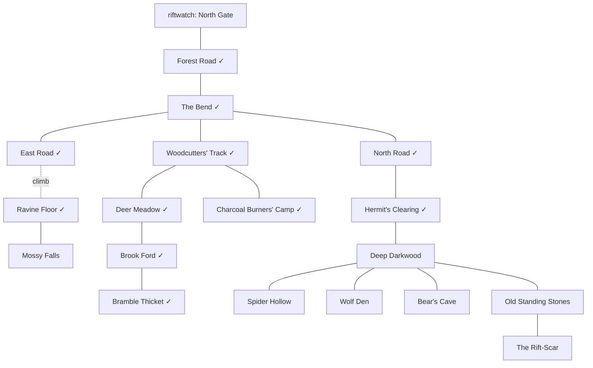

# The Darkwood

[Design summary](README.md) · Status: a design (2026-10-27), its open questions answered. Built: the road north from the gate, the Bend, the East Road and the Ravine Floor, the North Road and the Hermit's Clearing with its hedge-shaman, and (2026-10-27) [the west woods](#the-west-woods-as-built), rungs 2 and 3 (zone `forest`). Everything else here is proposed, for review.

The Darkwood is the first wilderness: the forest beyond Riftwatch's North Gate. It's where a new character goes once the sewers stop teaching them anything, and where foraging, herb-gathering, tracking and hunting come into their own. It grows more dangerous the further from the road you go: safe-ish near the gate, wild in the deep wood, and strange where the trees grow wrong around an old rift-scar.

**Built as data, wherever it can be.** Most of this is rooms, mob templates, spawns, finds and skills in RON, using what exists: allies and packs, reactions and conditions, Call for Help, breeding spawns. Where something can't be done in data, it's marked **(gap)** and collected in [What needs code](#what-needs-code), which is also the list the [scripting](effects.md#scripting) step is designed against.

## Map

**About 60 rooms** (decided 2026-10-27), about the size of Riftwatch and its sewers together, in five reaches out from the Bend. The map below shows the named places; each reach is filled out with more rooms of its kind between them (the counts in the table). Existing rooms are marked ✓.

| Reach | Rooms | Named places | Feel | Danger |
| --- | --- | --- | --- | --- |
| **The road** ✓ | 4 | Forest Road, the Bend, North Road, East Road, the Hermit's Clearing | Travellers' way; tracks of everything | Low: the odd boar wandering in |
| **The west woods** ✓ | 15 | Woodcutters' Track, the Charcoal Burners' Camp (the hunter's now), Deer Meadow, Brook Ford, Bramble Thicket | Logged-over, open, sunlit; game and herbs | Low to middle: for characters fresh from the sewers |
| **The ravine and the brook** | About 8 | Ravine Floor ✓, Mossy Falls (a swim behind the falls to a hidden ledge), the brook's banks | Damp, green, quiet; the best herbs | Low, but a climb and a swim to reach |
| **The deep wood** | About 30 | The Old Wood, Spider Hollow, the Wolf Den, the Bear's Cave, the Old Standing Stones | Dark, old, close; little light, few paths | Middle to high: **guard-strength** characters, around level-10 weapon skills |
| **The Rift-Scar** | About 4 | The Rift-Scar | A glade where the trees grow wrong and the air hums | High, and rare: the rift-touched |

- **A region, not a maze.** Thirty rooms of deep wood need landmarks and a few trails (a fallen giant, a stream to follow, the stones on their hill) so it can be learned; the rooms between them vary in description, finds and who lives there, rather than repeating. It's big enough to get turned around in, which makes **Navigation** and getting lost worth building ([What needs code](#what-needs-code)).
- **Danger by reach** (decided 2026-10-27): the west woods for characters past the sewers; the deep wood for those who could hold their own against a town guard; the bear, the old she-wolf and the Rift-Scar beyond that.

- **Environments:** `Forest` everywhere but the Deer Meadow (`Field`), Brook Ford and Mossy Falls (`Water` for its pool), and the Bear's Cave (`Cave`).
- **Terrain:** road on the road; uneven tracks; rough deep wood, thicket and scree; mud at the ford (easy tracking); wading at the brook and the pool (no tracks).
- **Climbs and swims:** the ravine (Climb 4, built), a swim behind Mossy Falls to a ledge with rare herbs (Swim 4), and a climb up the standing stones' hill.

### The west woods, as built

Built 2026-10-27: fifteen rooms west of the Bend, from the road's edge to the brook, with danger rising the further you go.

| Room | What's there |
| --- | --- |
| Woodcutters' Track, Old Track | The way in, off the Bend; crows overhead |
| Stump Field | An open clearing; rabbits |
| Charcoal Burners' Camp | **The hunter**: teaches Foraging and Tracking (Skinning and Butchering once harvesting is built), sells a hunting knife, waterskins and torches, buys trophies, pelts and meat |
| Birch Wood, Hazel Copse | Foxes; young boars root in the copse |
| Meadow's Edge, Deer Meadow | Rabbits (a breeding spawn, max 12) and the red deer (a breeding herd, max 6), all skittish |
| High Meadow | The **red stag**, who stands and fights (antlers 2–5, health 25), and **adders** basking (venomous) |
| Brook Ford | Where everything drinks; mud for tracks, watercress |
| Brook Bank, Sett Bank | The **badger** (thick hide, health 14) |
| Bramble Thicket | **Young boars**, two at a time |
| Boar Wallow | A **wild boar**: furious when badly hurt, and *Charge*s to knock you down |
| Reed Pool | **Giant frogs**, whose *Tongue* holds you |

- **Rungs:** rabbits, foxes, crows and adders are rung 2, with the young boars; the wild boar, frogs, badger and stag are rung 3 (the stag nearer 4). Numbers are first guesses for the calibration tool.
- **Traits, not passives:** what the design called *Boar's Fury*, *Venomous Bite* and *Thick Hide* are [traits](effects.md#traits) (`furious`, `venomous`, `thick_hide`), since they're what a creature is; skittish prey use `skittish`.
- **New natural attacks** (`beast.skill.ron`): peck, hooves (1–2), antlers (2–5), gore (2–5), and the techniques *Charge* (gore, knocks down) and *Tongue* (holds).
- **Who fights whom:** boars attack anything not a boar; deer, rabbits and foxes avoid rooms with a boar in them; adders and frogs strike only at people; the stag and badger only fight back.
- **Flora:** wild garlic in the woods; sorrel and chamomile in the meadows (`Field`); watercress at the brook and the pool (`Water`), which also has kingsfoil and moonpetal.
- **No pelts or meat yet:** they wait for harvesting, which comes next.

## The ladder: from the sewers to the deep wood

Decided 2026-10-27. Sewer rats and the stray dog are the only fights a new character has, and the deep wood is for those who could take on a guard; between them is a gap that would take forever to climb. A fight is worth experience only while it was at least a one-in-ten risk, so once a character outclasses rats they earn nothing from them, and their skills grow only from swings that end most fights in one. So content is built as a ladder of rungs, each a little harder than the last, and the west woods are the real next step after the sewers: their rooms run from safe beside the road to risky beside the deep wood, so a character finds their level by walking further in.

| Rung | Where | For | What's there |
| --- | --- | --- | --- |
| **0** | Riftwatch | Brand new | **Training dummies** in the training yard and the garrison yard (*built*): practise any weapon or technique safely, for skill practice and no experience. Sparring with the drill sergeant |
| **1** | The sewers' upper tunnels | First fights | Rats as now, **giant cockroaches**, **sewer snakes**, **rat swarms**, the smallest **oozes** ([the sewers' ecology](riftwatch.md#the-sewers-ecology)) |
| **2** | The forest's edge, the west woods; the sewers' west | Past the rats | **Rabbits and deer** (prey, with the startle window), **foxes**, **adders** (a poisoning bite), **young boars**, crows; **grey slimes** under the town. Foraging, herbs and harvesting between fights |
| **3** | The brook, the ravine; the Old Cistern, the Warren | Getting capable | **Grown boars**, a **badger**, **giant frogs** at the brook; the **Slime Lord** in the Old Cistern and the **Rat King** in the Warren, the sewers' two hard ends |
| **4** | The deep wood's edge | Guard-strength | **Lone wolves**, **forest spiders**, the **red stag** |
| **5** | The deep wood, the Wolf Den, the Bear's Cave, the Rift-Scar | Strong | **Wolf packs** and the **old she-wolf**, the **bear**, the **rift-touched** |

- **Tuning:** each rung is first guesses, to be played (issue #13). The one-in-ten cut-off for experience (`worthwhile_risk` in `progression.ron`) is a lever too, but the ladder is the real answer.
- **The fauna below** fills rungs 2 to 5; rung 0 is in Riftwatch and rung 1 in the sewers.

## Fauna

Each creature with what it does and which existing data does it. Numbers are first guesses, set against the sewer rats (Body 1, health 3) and the town guards (Body 6, level-10 skills).

| Creature | Where | How it behaves | Built from | Harvest |
| --- | --- | --- | --- | --- |
| **Fox** | West woods | Quick and wary: bolts like prey, but bites if cornered | *Skittish*, a bite (1–3) | A fox pelt |
| **Adder** | West woods, the road's verges | Lies still; bites if trodden near, and the bite poisons | `aggressive` with no `allies`, so only at players; *Venomous Bite* | A snakeskin; a venom sac |
| **Young boar** | West woods | A boar not grown into its temper: rung 2's fighter | As the boar, weaker | Pork |
| **Badger** | Brook, west woods' far edge | Stubborn and tough for its size; fights to the end | High Body, *Thick Hide* | A badger pelt |
| **Giant frog** | Brook Ford | Leaps out of the water; a sticky tongue that holds | A technique *Tongue*: `Apply(held)` | Frog legs (meat) |
| **Rabbit** | Meadow, west woods | Breeds fast, harmless; bolts from anyone (*built*: `Flee`) | Breeding spawn, `crowd`, `tags: ["game"]`; *Skittish* (see [Prey](#prey-a-window-then-gone)) | Meat; a rabbit pelt |
| **Red deer** | Meadow, brook | A small herd, wandering the west woods; bolts (*built*: `Flee`); a stag fights back hard | Breeding spawn with `reseed`; `tags: ["game"]`; the stag a `Keep(1)` spawn with a gore attack; *Skittish* | Venison; a hide; antlers (stag) |
| **Wild boar** | Thicket, west woods, the road now and then | Bad-tempered: attacks anyone not a boar; **enrages** when hurt | `aggressive`, `allies: ["boar"]`; passive skill *Boar's Fury*: reaction `Hurt(0.5)` → `Apply(strengthened)` on itself | Pork; a tusk |
| **Grey wolf** | Wolf Den, the deep wood (more at night **(gap: time-of-day spawns)**) | Hunts in packs of three; goes for game and travellers alike; **howls** for the pack when hurt | `aggressive`, `allies: ["wolf"]`, `pack: 3`, `tags: ["wolf"]`; *Howl*: Call for Help with the wolves' own words | A wolf pelt; fangs |
| **The old she-wolf** | Wolf Den | The pack's leader: while she lives, every wolf in the Darkwood fights better | An `Aura` skill, as the Rat King's, affecting `forest:grey_wolf`; `AfterDeath(Days(7))` | A great grey pelt (rare) |
| **Forest spider** | Spider Hollow | Waits in its web **(gap: mobs hiding and ambushing, #9)**; a bite that poisons | `aggressive`; passive *Venomous Bite*: reaction `Hits` → `Apply(poisoned)` | Spider silk; a venom sac |
| **Brown bear** | Bear's Cave | Solitary and huge; ignores you on the paths, savage at home **(gap: territorial)** | `wander: Never`, high Body and Strength, natural armour (*Thick Hide*: `Armour` bonus), a maul | A bear pelt; claws, bear meat |
| **Crows** | The road, the clearing | Atmosphere: they watch, and caw **(gap: ambient lines)** | A `here` line, `wander: Zone` | Nothing |
| **The rift-touched stag** | The Rift-Scar | Rare and strange: glowing antlers, lightning-quick; what hurts it hurts back | A `rift_touched` trait (resist force, `Struck` → force damage, as thorns; [traits](effects.md#traits) *built*); `AfterDeath(Days(3))`; a Silver contract later | A vitae crystal, left where it dies (loot: what the rift left in it; rare, a crafting reagent later); its antlers to harvesting |

**Food chain, from what's built:** wolves and boars are `aggressive` with allies of their own kind only, so they go for deer and rabbits as readily as players; deer and rabbits aren't aggressive, so they're prey. Without fleeing, prey just stands and dies, which is why fleeing is the first gap worth closing.

### Prey: a window, then gone

Decided 2026-10-27. Deer and rabbits bolt, but not the instant someone walks in: there's a window a quick hunter can strike into, so taking one is a little hard, not wildly so, and a slow typist still has a fair chance.

- **Startled, then off** (*built*). A non-ally the prey notices coming in startles it (`startled`, a condition lasting a few seconds); when that runs out, it flees. In data, the *skittish* [trait](effects.md#traits): `Arrives`, `only: Foes` → `Apply(startled, lasts: Rounds(2))`, and `startled`'s own `Fades` → `Flee`. How long the window lasts is the condition's length: a tuning number, first guess 6 seconds (two rounds).
- **Caught in the window, it fights to get away:** once in a fight, prey tries to break off as a player does with `flee`, a chance each turn rather than a certainty (*Skittish*: half its turns, `TurnStarts` with `chance: "0.5"`, each try succeeding as `flee` does, 60% before Luck), and once more when badly hurt (`Hurt(0.5)` → `Flee`). A hunter usually gets a blow or two in.
- **Stealth pays.** `Arrives` fires only for someone the prey noticed, so a sneaking hunter walks right up without startling it; a sharp-eyed deer (good Intuition) notices more.

### Harvest what's cut, loot what's left

Decided 2026-10-27. **What has to be cut from a carcass is harvested; what a creature leaves behind just by dying falls as loot.** A beast's pelt, meat, fangs and antlers are worked out of its corpse with a skill, while it lasts (a mob's corpse rots in 5 minutes). But a slime *is* jelly, so the jelly is simply there when it's gone; a rift-touched creature leaves its vitae crystal; and loot tables stay for what a creature carries, a bandit's knife, a guard's coins. Something with no body to leave (the `formless` trait: slimes) leaves no corpse at all, and its loot lies where it died.

- **Two new Survival skills,** made of effects: **Skinning** (hides, pelts, silk) and **Butchering** (meat, and trophies: fangs, tusks, antlers, claws, a venom sac). Each is `Find` aimed at a corpse, the user's skill against its difficulty, the better made the more surely it went, as foraging is.
- **In data,** a creature's template says what its corpse yields, by kind: `harvest: {"hide": [("wolf_pelt", 1)], "meat": [(None, 20), ("wolf_meat", 80)]}`, and Skinning finds `"hide"`, Butchering `"meat"`. Each kind can be taken from a corpse once; a fumble spoils it.
- **The corpse's rot timer is the window** for harvesting, and a corpse taken whole could be carried home to work later (it's an item).
- **The sewers too:** sewer rats drop a rat's tail as loot today, and the Rat King his tooth. Both are cut from an animal, so they move to harvesting once it's built. The slimes' jelly and the Slime Lord's heart of the deep stay loot.

**New natural attacks** (data, `beast.skill.ron`): a wolf's bite (2–4), a boar's gore (2–5, with a knock-down technique, *Charge*: `Apply(down)`), a bear's maul (3–6), a stag's antlers (2–5), a spider's fangs (1–3).

**New passives** (data): *Boar's Fury*, *Venomous Bite* and *Thick Hide* (built as traits: `furious`, `venomous`, `thick_hide`), *Howl*, and *Pack Hunter* (wolves get an attack bonus with more of the pack in the fight **(gap: a bonus that counts allies present)**).

## Flora

The forest's finds, by place: the existing tables stay, and the deep wood and the ravine get the rarer things.

| Where | Forage | Herbs | New kinds (later skills) |
| --- | --- | --- | --- |
| The road, west woods | Wild berries, hazelnuts, wild garlic | Yarrow | `"wood"` for Woodcutting |
| Deer Meadow | Wild berries, sorrel | Yarrow, kingsfoil, chamomile | |
| Brook Ford, Mossy Falls | Watercress | Kingsfoil, moonpetal | `"fish"` for Fishing |
| Ravine, the falls' ledge | Mushrooms | Moonpetal, frostfern (rare) | |
| Deep wood | Mushrooms, deathcap (poisonous to eat) | Foxglove, nightshade (poisons, for Brewing later) | `"wood"` (ironbark) |
| The Rift-Scar | Nothing wholesome | Riftbloom (rare, glows) | |

- **All data:** each is an item template plus a finds table; new kinds like `"wood"` and `"fish"` are just tables until a skill finds them (Woodcutting, Fishing: new skills made of `Find`).
- **Poisonous food** (deathcap): eating it should poison you: a consumable whose `effects` `Apply` `poisoned` (*built* 2026-10-29, the mushroom itself not yet).
- **Honey from a bee tree:** foraging it angers the bees **(gap: a find with a consequence)**.

## Hazards and atmosphere

- **Bramble Thicket:** pushing through scratches **(gap: room reactions: `Enters` → `Damage`)**, and it's rough going.
- **Spider Hollow's webs:** walking in, you may be caught (`held`) **(gap: room reactions)**.
- **The deep wood is dark:** hard to see in, and harder at night **(gap: room conditions, darkness and sight)**. A torch would help (torches exist, but light nothing yet).
- **Getting lost** in the deep wood without Navigation **(gap, later: a Navigation skill and lost-ness)**.
- **The Rift-Scar** hums: anyone who lingers is slowly worn down, unless warded **(gap: room conditions with `Every` reactions)**. It hints at the wider story without explaining it: what the rifts are stays open until the setting is decided.
- **Night** changes the forest: more wolves, fewer deer **(gap: time-of-day spawns)**.

## People and work

- **The hedge-shaman** ✓ in the Hermit's Clearing: Awakens Shamans, teaches Tracking.
- **A hunter** at the Charcoal Burners' Camp, newly moved in (decided 2026-10-27: a new trainer and shop; *built*, teaching Foraging and Tracking until Skinning and Butchering exist): teaches Skinning, Butchering and Foraging, and later Bows **(gap: ranged combat)**; buys pelts, fangs, antlers and meat. A trainer and a shop are data.
- **What sells:** the provisioner buys meat (food), the herbalist herbs; the hunter pelts, fangs and antlers, all of them harvested, not looted. The hunter teaches Skinning and Butchering. Item values and shop `buys` are data.
- **Contracts** (when quests exist, [Quests](quests.md)): cull the wolves (Copper), bring the old she-wolf's pelt (Bronze), the rift-touched stag (Silver).

## What needs code

The gaps above, each with the smallest shape that would close it, in the order they'd matter for the Darkwood:

| Gap | Needed for | Proposed shape | Size |
| --- | --- | --- | --- |
| **Fleeing** (*built* 2026-10-27) | Deer and rabbits, a hurt wolf breaking off | A `Flee` effect, as the `flee` command: out of a fight, the bearer leaves by a random walkable exit, away from what it avoids; in one, a chance to break away. Data does the rest: the *skittish* trait puts `startled` on at `Arrives`, `only: Foes` (so other deer don't startle it), for `Rounds(2)`, and `startled` `Fades` → `Flee`, which makes the window ([Prey](#prey-a-window-then-gone)); in a fight it tries to break away half its turns, and on `Hurt(0.5)` | Small to medium |
| **Harvesting corpses** | Pelts, meat, fangs, antlers | `harvest` tables on mob templates, carried onto the corpse; `Find` aimed at a corpse (`aim: Item`) finding a kind from it, once per kind; Skinning and Butchering as data | Small to medium |
| **Mob conditions from the start, and traits** (*built* 2026-10-27) | The rift-touched stag, the grey slimes, the Slime Lord; any template that "is" something | What a mob *is* is a [trait](effects.md#traits): `traits: ["rift_touched"]`, kept through cures and death. What's merely happening to it from the start is a condition: `conditions: [(condition: "hidden", strength: 8)]`, so a mob born `hidden` lurks unseen until noticed, the start of [#9](https://github.com/Foxworks-Studios/riftward/issues/9)'s ambushers | Small |
| **Consumables that apply conditions** (*built*) | Deathcap poisoning, later potions of strength | `effects: [...]` on a `consumable`, resolved on the eater | Small |
| **Time-of-day spawns** | Night wolves, day deer | The spawn `when` condition gains `TimeOfDay(Night)` (designed in [world.md](world.md)) | Small |
| **Ambient lines** | Crows, the hum of the scar, birdsong | `chatter: ["The crow caws.", ...]` on a mob or room, one now and then on the heartbeat | Small |
| **Territorial aggression** | The bear | `aggressive` only in its spawn's room: `aggressive: Home` | Small |
| **Room conditions and reactions** | Thickets, webs, darkness, the Rift-Scar's hum | Rooms carry conditions as characters do; their reactions fire on `Enters` and `Every` for whoever is there | Medium |
| **Mobs hiding and ambushing** | The spider in its web | Issue #9: mobs use Stealth out of a fight, and open from hiding | Medium |
| **A bonus that counts allies present** | *Pack Hunter* | A passive bonus `per` ally in the fight, or a formula input `allies` | Small to medium |
| **`avoids` on templates** (*built* 2026-10-27) | Rats kept from draining into the slimes ([the sewers](riftwatch.md#the-sewers-ecology)); deer keeping out of the wolf den | `avoids: ["slime"]`, by tag or template as `allies` are: wandering and crowding never take a mob into a room holding what it avoids. Only what's named, so rats still go for guards and players. Later, fleeing prefers exits away from it | Small |
| **Things, not creatures** (*built* 2026-10-27) | Training dummies | The `inanimate` trait on a template: it takes blows and never acts in a fight, never wanders or picks one, is worth no experience nor a tough-fight boost, and leaves no corpse; it's battered and knocked to pieces, not hurt and killed | Small |
| **Spawning from an effect** (*built* 2026-10-27) | Slimes splitting, the Slime Lord shedding slimes | A `Spawn(mob, count)` effect, in a reaction on `Hurt` or on the dying one's own `Dies` (`Kills` is the killer's). They appear where the user is and fight its foe; they belong to no spawn, so they don't come back. To keep a split from splitting for ever, the halves are a template of their own without the reaction | Small to medium |
| **Acid that eats gear** | The sewers' slimes | An `acid` damage type is data; acid wearing armour and weapons down needs item condition and wear **(later)** | Later |
| **Ranged combat** | Bows, the hunter's teaching | Attacking into the next room, ammunition | Large, later |
| **Rift-touched mutations** | Now and then a monstrous variant instead of an ordinary creature, more often near the Rift-Scar ([planned](world.md#rift-touched-mutations-planned)) | A pool of mutations as data, rolled on a spawn's small chance; each is mostly conditions the mob is born with, plus words and extra harvest | Medium, later |
| **Navigation and getting lost** | The deep wood's thirty rooms | Without Navigation, a move in the deep wood may take you a different way than you meant, more often the further from a landmark; Navigation (Survival) against how tangled the wood is. Rooms say how easy they are to lose your way in | Medium |

## Proposed build order

1. **The low rungs first** (decided 2026-10-27): training dummies in town (*built*), the sewers' new ecology ([riftwatch.md](riftwatch.md#the-sewers-ecology)), and the west woods with their rung-2 and rung-3 creatures and flora, before the deep wood.
2. **Rooms and flora** (data): the rest of the forest: the ravine's falls, the deep wood, the stones and the scar, with their finds and the new herb and food items.
3. **The fauna that works today** (data): boars with *Boar's Fury*, wolves with *Howl* and the old she-wolf's aura, spiders with *Venomous Bite*, the bear with *Thick Hide*, the deer and rabbits as breeding prey, crows. No material loot: what they yield waits for harvesting.
4. **Harvesting** (code, small to medium): `harvest` tables and `Find` from a corpse, then Skinning and Butchering as data.
5. **Fleeing** (*built*), with the startled window, then deer and rabbits bolt and a beaten wolf runs.
6. **Mob starting conditions and traits** (*built*), for the rift-touched stag; **consumables with effects** (*built*) for deathcaps.
7. **Time-of-day spawns** and **ambient lines** (code, small).
8. **Room conditions and reactions** (code, medium), for the thicket, the webs and the scar; mobs hiding (#9) for the spider's ambush.

## Open questions

- [x] **How big:** about 60 rooms, the deep wood a region of about 30 with landmarks and trails (2026-10-27).
- [x] **Levels:** the west woods for characters past the sewers, the deep wood guard-strength (level-10 weapon skills), its bosses beyond (2026-10-27).
- [x] **The Rift-Scar:** a hint of the wider story now: a strange glade, the rift-touched stag and riftbloom, description that suggests without explaining, until the setting is decided ([Riftwatch](riftwatch.md#open-questions)) (2026-10-27).
- [x] **The hunter:** a new trainer and shop at the charcoal camp (2026-10-27).
- [ ] **Navigation:** build getting lost with the deep wood, or after it?
