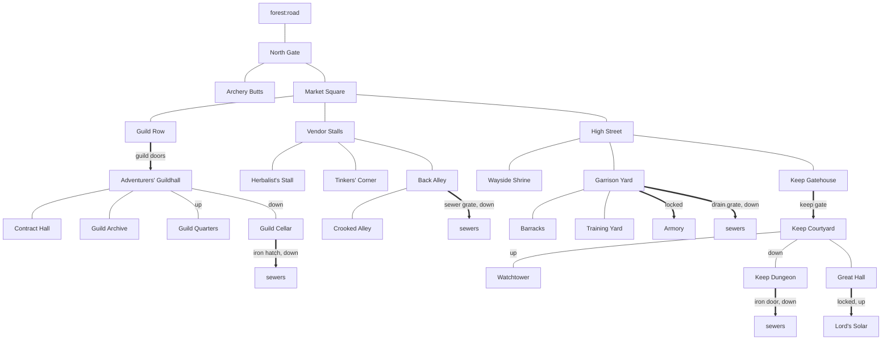
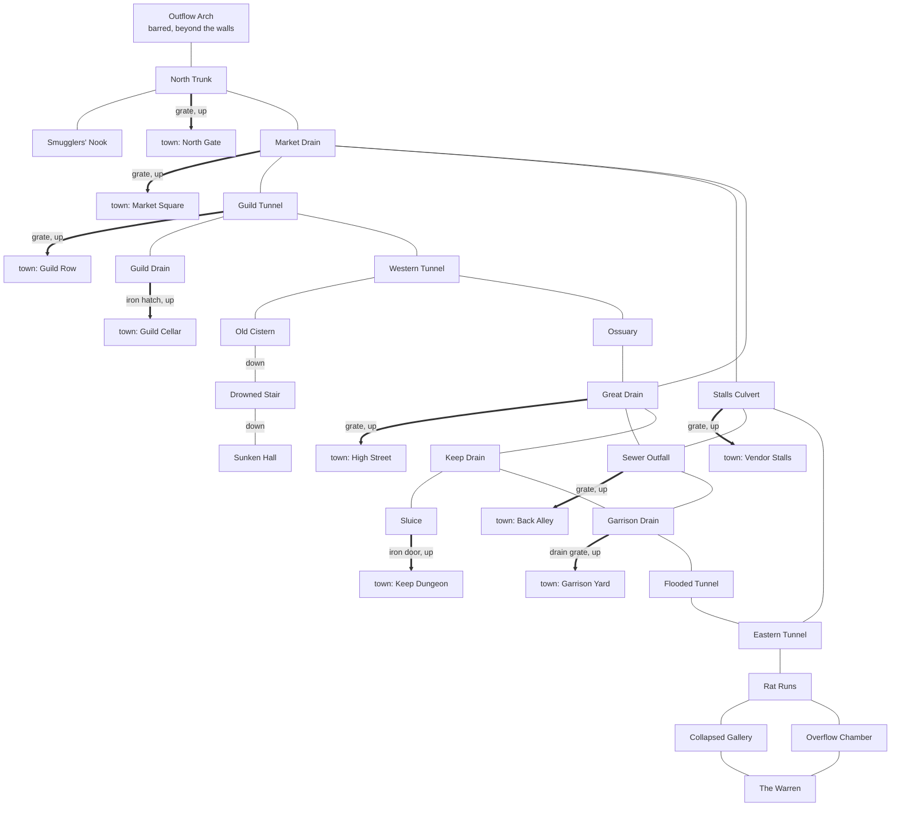

# Riftwatch

[Design summary](README.md) · Status: rooms, doors, mobs and trainers built (zones `riftwatch`, `sewers`, and `forest` for the road north), and the rats breed

Riftwatch is the starting town. Every new character begins in its market square, and it's the hub players return to between ventures. It holds the Adventurers' Guild, an open-air market, the garrison, the lord's keep, and beneath it all a sewer system as large as the town itself: 26 rooms above, 23 below, joined by nine grates, hatches and doors. Room descriptions only lightly touch the setting (the barrier's shimmer from the watchtower, adventurers drawn by the rifts); change anything that doesn't fit [the setting](setting.md).

## Map

North is up: the North Gate opens onto the forest road, the market is the centre, the guild lies west, the stalls east, and High Street runs south to the garrison and the keep.

## The sewers

The sewers are dark ([Light and darkness](world.md#light-and-darkness)): bring a torch, since the rats, roaches, snakes and slimes all see in the dark. They mirror the town above, a tunnel beneath each district, and loop rather than dead-end, so the rats have room to spread.

| Under | Sewer rooms |
| --- | --- |
| North Gate | Outflow Arch, North Trunk, Smugglers' Nook |
| Market | Market Drain, Stalls Culvert, Sewer Outfall |
| Guild | Guild Tunnel, Guild Drain, Western Tunnel, Old Cistern, Drowned Stair, Sunken Hall |
| High Street and shrine | Great Drain, Ossuary |
| Keep | Keep Drain, Sluice |
| Garrison | Garrison Drain, Flooded Tunnel |
| East, the rats' territory | Eastern Tunnel, Rat Runs, Collapsed Gallery, Overflow Chamber, The Warren |

Nine ways connect the sewers and the town. The street grates are closed but unlocked, so anyone can climb down, and rats can come up once one is left open:

| From town | Down to | Starts |
| --- | --- | --- |
| North Gate | North Trunk | Closed |
| Market Square | Market Drain | Closed |
| Guild Row | Guild Tunnel | Closed |
| High Street | Great Drain | Closed |
| Vendor Stalls | Stalls Culvert | Closed |
| Back Alley | Sewer Outfall | Closed |
| Garrison Yard | Garrison Drain | Locked |
| Guild Cellar | Guild Drain | Locked |
| Keep Dungeon | Sluice | Locked, very hard to force |

From any room, `look <direction>` shows what lies that way and who's there, including through an open grate.

## Districts

| District | Rooms |
| --- | --- |
| Gate | North Gate, Archery Butts |
| Market | Market Square (start room), Vendor Stalls, Herbalist's Stall, Tinkers' Corner, Back Alley, Crooked Alley |
| Guild | Guild Row, Adventurers' Guildhall, Contract Hall, Guild Archive, Guild Quarters, Guild Cellar |
| High Street | High Street, Wayside Shrine |
| Garrison | Garrison Yard, Training Yard, Barracks, Armory |
| Keep | Keep Gatehouse, Keep Courtyard, Watchtower, Great Hall, Lord's Solar, Keep Dungeon |
| Sewers | 23 rooms; see [The sewers](#the-sewers) |

## Doors

| Door | Between | Starts | Lock |
| --- | --- | --- | --- |
| A pair of iron-banded doors | Guild Row, Guildhall | Open | None |
| Five street grates | See [The sewers](#the-sewers) | Closed | None |
| A rusted sewer grate | Back Alley, Sewer Outfall | Closed | None |
| A reinforced armory door | Garrison Yard, Armory | Locked | The armory key; pick 6, bash 6 |
| An iron-studded gate | Keep Gatehouse, Keep Courtyard | Open | Bash 12, can't be picked |
| A carved oak door | Great Hall, Lord's Solar | Locked | The solar key; pick 8, bash 8 |
| An iron hatch | Guild Cellar, sewers' Guild Drain | Locked | The cellar key; pick 4, bash 5 |
| A barred drain grate | Garrison Yard, sewers' Garrison Drain | Locked | The armory key; pick 4, bash 6 |
| A rusted iron door | Keep Dungeon, sewers' Sluice | Locked | The dungeon key; pick 10, bash 12 |

The keys are item templates in the zone, but none is spawned or carried yet; an admin can `create` one.

## Who's about

| Spawn | Where | Keeps | Wanders |
| --- | --- | --- | --- |
| Town guards (deadly to a new character, on purpose: a match for a character of level 8, so one kills a new character, often in a round, and a guard losing a fight calls the others; decided 2026-10-30; Toughness 10, from 15 when health became 8 + Body + Toughness: one alone beats a level 8 character about four times in ten) | North Gate, Market Square, Garrison Yard | 2 each, 6 in all | Anywhere in town, every 1-3 minutes |
| Keep guards (the lord's household troops, a match for a character of level 12; Toughness 14, from 20) | Keep Gatehouse, Great Hall | 2 each | No |
| A stray dog (goes for rats and other vermin, `enemies: ["vermin"]`, but doesn't answer the guards' calls for help) | Market Square | 1 | Market, stalls, back alley, tinkers, Guild Row |
| Alley rats (not aggressive: they fight only when attacked; a little easier than the stray dog, two at once about the same; back two minutes after they're killed) | Crooked Alley, off the Back Alley | 3 | No |
| Straw training dummies (the `inanimate` trait: they never hit back, for safe practice) | Training Yard (2), Garrison Yard (1) | 3 | No |
| Marin Harrow, the contract clerk | Contract Hall | 1 | No |
| Narina Greenthorn, the herbalist | Herbalist's Stall | 1 | No |
| Sergeant Alina Greaves, the drill sergeant | Training Yard | 1 | No |
| Sewer rats (aggressive: they attack anyone who comes near) | The Warren | Breed from 8, doubling every 4 hours up to 200; back a week after they're wiped out | Anywhere, through open grates too, but only when crowded: 6 to a room |

The herbalist's stall, Contract Hall, Guild Archive, Guild Quarters, shrine and Lord's Solar turn wanderers away.

Item spawns keep a few things in place:

| Spawn | Where | Keeps | Resets |
| --- | --- | --- | --- |
| A weathered signpost (fixed) | Market Square | 1 | Every hour |
| An old oak chest (fixed, locked), with two loaves of bread, a waterskin and a torch | Guild Cellar | 1 | Every hour, topping up its contents |
| Wooden practice swords | Training Yard | 2 | Every 30 minutes |
| A padded jack, a leather cap and a buckler | Training Yard | 1 each | Every 30 minutes |
| A mail shirt, an iron helm, a round shield, gauntlets and greaves | Armory | 1 each | Every hour |
| A rolled parchment | Guild Archive | 1 | Every 2 hours |

The chest's key isn't spawned anywhere yet either; a mob could carry it now that mobs carry things.

## Where trainers go

Each basic skill has a home in town. Trainers teach Common and Uncommon skills (see [Acquiring skills](skills.md#acquiring-skills)).

| Room | Trainers |
| --- | --- |
| Training Yard | Sergeant Alina Greaves: the basics of every weapon (Swordplay, Knife, Axe, Hammer and Staff Fighting), Toughness, Climbing, Swimming, Heavy Armour and Block. *Built* |
| Archery Butts | Archery |
| Guild Archive | The magister, who Awakens Hermetic students (*built*); later Lore, and the self-taught **Study** path |
| Herbalist's Stall | Narina Greenthorn: Herbalism, Foraging, First Aid and Brewing, with bear's blood taught; a brazier to brew at; sells bandages, draughts, antidotes, vials and brewing kettles (*built*) |
| Wayside Shrine | The keeper of the shrine, who Awakens Divine students and teaches Mend and Bless (*built*); later Healing, and the **Devotion** path |
| Back Alley | A hooded figure (Talla Mirk): Stealth, Lockpicking and Pickpocketing (*built*) |
| Tinkers' Corner | Crafting and repair |
| Market stalls | Harwin Colm, the provisioner: Haggling and Appraisal (*built*) |
| Watchtower | An old ascetic, who Awakens Adepts (*built*) |
| Darkwood, Hermit's Clearing | Outside town: the hedge-shaman, who Awakens Shamanic students and teaches Tracking (*built*); see [The Darkwood](darkwood.md) |
| Contract Hall | Not a trainer: the guild's contract board and clerk (see [Quests and the Adventurers' Guild](quests.md)) |

Guild trainers beyond these can require a guild rank, such as a weaponmaster who only teaches Silver members; the ones above stay open to everyone.

## The rat problem

The sewers are built for the breeding spawn described in [The living world](world.md#spawns-and-resets):

- **The Warren** (`sewers:nest`) is the nest. Rats breed there and spread by crowding, first through the Rat Runs, Collapsed Gallery and Overflow Chamber, then into the rest of the sewers.
- **Six street grates lead up,** all closed at the start. Left alone, rats crowd toward them; an open grate lets them into the street above. The locked ways up (guild, garrison, keep) hold them back unless someone opens them.
- **They fight in threes.** Rats are aggressive, but no more than three take on one player at once (`pack: 3`); the rest wait their turn. Tuned by simulation against a fresh Soldier with their short sword: about two rats a trip in the Warren before resting at a third of their health, more one at a time in the outer tunnels, and about one under the Rat King. A rat's bite does 1 or 2 (`beast:rat_bite`; a single point until 2026-10-30).
- **A breakout raises the Rat King.** The first rat to reach the city through an open grate sets off an alarm in the streets, and the Rat King appears in the Warren, making every rat in the sewers tougher until someone kills him. See [The Rat King](world.md#the-rat-king-built).
- **Hooks for later:** the barred Outflow Arch (a way beyond the walls), the Smugglers' Nook (someone's been using it), the Ossuary under the shrine, and the Drowned Stair beneath the Old Cistern, which is far older than the sewers and carved in an unknown script.

## The sewers' ecology

*Built* (2026-10-27). The rats are the sewers' east, and a second ecology takes the west: **slimes**, bred in the Old Cistern's black water. The two meet in the middle tunnels and fight there, since neither counts the other an ally. With a few small creatures besides, the sewers become the first two tiers of [the ladder](darkwood.md#the-ladder-from-the-sewers-to-the-deep-wood), not just rats.

| Creature | Where | Tier | How it behaves | Built from |
| --- | --- | --- | --- | --- |
| **Giant cockroach** | Bred in the North Trunk, wandering the whole zone | 1 | Harmless-ish; startles and scuttles off | Breeding spawn (max 20, crowd 2), a weak bite, `tags: ["vermin"]`, the `skittish` trait; avoids slimes |
| **Sewer snake** | The Flooded Tunnel | 1 | Strikes at people who come near; the bite sometimes poisons | `aggressive` (players only), `tags: ["vermin"]` so the rats leave it be, the `venomous` trait (`Hits`, 30% → `poisoned`) |
| **Rat swarm** | The Overflow Chamber | 1 | Four more rats, four at a time | A `Keep(4)` spawn of sewer rats with `pack: 4` |
| **Ooze** | Bred in the Cistern, spreading to the Western Tunnel and the Ossuary | 1 | Slow, two at a time at most (`pack: 2`), health 8, *Acid Touch* 1–2 at 6; struck hard, a piece tears off and keeps coming | `aggressive`, `allies: ["slime"]`, `tags: ["slime"]`; *Acid Touch* (`acid`, a damage type armour stops for now); traits `formless` and `splitting` (`Hurt(0.5)` → `Spawn` a torn-off ooze, a template of its own that doesn't split again) |
| **Grey slime** | The Ossuary, two, staying put and fighting together (`pack: 2`, since 2026-10-30; one at a time before), so the Western Tunnel, the way in from the rats' side, is tier 1 | 2 | Shrugs off blades and fists, burns at fire: torches and Hermetic sparks matter here | As the ooze, tougher; traits `formless` and `rubbery` (`Resist(physical, 0.5)`, `Weakness(fire, 0.5)`) |
| **The Slime Lord** | The Old Cistern | 3 | A heaving mass in the black water: while it lives, every slime in the sewers fights a little better; hurt, it sheds oozes, and it knits itself whole as it fights | *Slime Lord's Will*, an aura over the `slime` tag (+1 attack and defence); traits `formless`, `rubbery`, `mending` (2 health a turn) and `shedding` (oozes at three quarters, half and a quarter of its health); `AfterDeath(Days(3))`; its death is announced in the sewers |

- **Slimes eat rats, at a border.** Slimes are aggressive to anything that isn't a slime, rats to anything that isn't vermin, so where they meet they fight, and a player arriving mid-fight finds both sides weakened, or both turned on them. But they meet only at the edges (decided 2026-10-27), or the slimes would end the rat problem: a crowded rat moves to the neighbouring room with the fewest *rats*, so a room of slimes looks empty to it, and rats would flow west and die there for ever. With always an emptier way to go, they'd never gnaw through a grate, and the breakout would never come. So:
  - **Rats avoid slimes** (`avoids` on templates, *built*): a template names what its mobs keep away from, by tag or template, `avoids: ["slime"]`, and wandering or crowding never takes them into a room holding one. Only what's named: rats still go for guards, dogs and players, and still pour into the streets in a breakout (decided 2026-10-27; treating every enemy as a reason to stay out would have kept rats from any room with a guard or a player in it). So rats pile up on their own side, the pressure builds toward the eastern grates as before, and the breakout comes as designed. Prey keeps out of a predator's den the same way in the [Darkwood](darkwood.md): deer `avoids: ["wolf", "boar"]`.
  - **Slimes keep to their own tunnels** (data): the oozes wander only among the Cistern, the Western Tunnel and the Ossuary, and the grey slimes stay in the Ossuary. Coming from the rats' side, the Western Tunnel holds only oozes (tier 1), the Ossuary the grey slimes (tier 2) and the Cistern the Slime Lord (tier 3); tuned 2026-10-27, after the first oozes and both grey slimes sharing the way in killed a new mage at once.
  - **The Guild Tunnel and the Ossuary are the border:** both sides can reach them, and slimes don't avoid rats, so a slime pushed in among rats means a fight: skirmishes when the slimes push, not a constant drain. The rats' way to the city, the Stalls Culvert, is on their own side, four rooms from the Warren, so the border doesn't stand between them and a breakout.
- **Loot, not harvest:** a slime *is* jelly, so it leaves **slime jelly** where it dies, no corpse (a reagent: two make a [slimeskin draught](crafting.md#brewing)), and the Slime Lord a **heart of the deep** (rare). See [Harvest what's cut, loot what's left](darkwood.md#harvest-whats-cut-loot-whats-left).
- **Two hard ends:** the Rat King in the Warren and the Slime Lord in the Cistern are tier 3, so a character can go one way or the other.
- **Rift-touched mutations** ([planned](world.md#rift-touched-mutations-planned)) turn up here too, more often in the undercity: a rift-twisted rat, a slime that glows.

### Tuned against new characters

Tuned 2026-10-30 with the balance tool (`src/combat/balance.rs`), as the [deep wood](darkwood.md#tuned-against-parties) was: the rats' side and the slimes' side are separate reports (`balance_sewer_rats`, `balance_sewer_slimes`), with Crooked Alley's rats and the stray dog in a third (`balance_town`). Level 0 is a new character with a sword from a trainer (swordplay 2, Dodge 1); level 1 (swordplay 6, Dodge 5) is about an hour's play, level 2 adds a jerkin. Before, nothing in the sewers but the Slime Lord could kill a new character, and the Slime Lord, mending as fast as swords bit through its rubbery mass, beat every party.

| Encounter | Party (level × size) | Wins | Deaths a fight |
| --- | --- | --- | --- |
| An alley rat | 0 × 1 | 99% | 0.01 |
| Two alley rats | 0 × 1 | 81% | 0.19 |
| The stray dog | 0 × 1 | 81% | 0.19 |
| A sewer rat, an ooze, a cockroach | 0 × 1 | 99–100% | 0.01 |
| The sewer snake | 0 × 1 / 1 × 1 | 48% / 98% | 0.52 / 0.01 |
| Three rats | 0 × 1 / 1 × 1 | 52% / 100% | 0.48 / 0 |
| The swarm (four rats) | 0 × 1 / 0 × 2 / 1 × 1 | 22% / 90% / 100% | 0.78 / 0.34 / 0 |
| A grey slime | 1 × 1 / 2 × 1 | 61% / 100% | 0.39 / 0 |
| Two oozes | 0 × 1 / 1 × 1 | 87% / 100% | 0.13 / 0 |
| Two grey slimes | 1 × 1 / 2 × 1 / 3 × 1 | 0% / 80% / 97% | 0.99 / 0.20 / 0.03 |
| The Rat King and three rats | 2 × 3 / 3 × 2 / 3 × 3 | 60% / 59% / 98% | 1.90 / 1.14 / 0.52 |
| The Slime Lord | 2 × 3 / 3 × 2 / 3 × 3 | 52% / 48% / 99% | 1.99 / 1.31 / 0.37 |

- **What changed:**
  - **Sewer rats:** Rat Bite does 1–2, not 1 (cockroaches bite with it too), Dodge 2, health 3 → 4.
  - **The snake:** bite 3 → 4, Dodge 3, health 5 → 7.
  - **Oozes:** Acid Touch 2 → 6, Dodge 2, health 4 → 8.
  - **Grey slimes:** Acid Touch 4 → 9, Dodge 3, health 12 → 18.
  - **The Rat King:** bite, claw and rend 8 → 13, Dodge 9, health 30 → 45.
  - **The Slime Lord:** Acid Touch 8 → 14, Dodge 6, health 40 → 50.
  - **Retuned for more health** (2026-10-30): characters' health became 8 + Body + Toughness (12 at level 0, 20 at level 3), so the tier 2 and 3 fights got more health to match, and kept their damage: grey slimes 18 → 24, the Rat King 45 → 70, the Slime Lord 50 → 80. The Rat King now wins about 56% for three at level 2 and 80% for two at 3; the Slime Lord 46% and 55%. A new character gained only 2 health, so the tier 0 and 1 fights are a little easier than the table: a pack of rats at level 0 about 65%.
  - **Packs:** oozes and grey slimes fight two at a time (`pack: 2`, was 1), so the Ossuary is a real fight at level 2, not a sure thing, and still no place for level 1. The rats stay at three: a rat's bite rarely lands on a level-1 character, so six at once still lose nine fights in ten, and more at once would only punish new characters in the Warren, who already lose to four rats at once most of the time.
- **One of anything is safe; it's numbers that kill.** A single rat or ooze does 1 or 2 a bite and dies to one or two blows, so alone it's a new character's first fight, worth little; packs and the swarm are where the risk, and the experience, are. An hour's play outgrows the upper tunnels, as [the ladder](darkwood.md#the-ladder-from-the-sewers-to-the-deep-wood) means it to.
- **A jerkin matters against slimes:** armour stops acid, so a grey slime that's a gamble at level 1 is safe at level 2 in leather.
- **The reports fight in the light and with swords only.** The sewers are dark, so without a torch a player fights at half, and the night-eyed rats and slimes don't; and fire, which slimes fear, would make the west easier.
- **The Slime Lord sheds more the longer it lasts** (a feature, decided 2026-10-30): five oozes if each line is crossed once, but `Hurt` fires each time a blow takes it below a line, and mending lifts it back above one, so a party that only nibbles around a line sets it off again and again. Big hits cross each line once; chip damage buries a party in oozes. It's part of why it wants a party.

### Larger sewers

The sewers have hooks already: the Drowned Stair beneath the Old Cistern, the Sunken Hall carved in an unknown script, the Ossuary under the shrine, the barred Outflow Arch, the Smugglers' Nook. Growing the sewers grows tiers 1 to 3:

- **The undercity:** below the Drowned Stair and the Sunken Hall, the old city itself (see below): its streets and halls, flooded, collapsed and sealed, a lower level of the sewers, darker, with the slimes' source and stranger things, for tier 3 and beyond. Much larger than the sewers above it, as the old city was larger than Riftwatch, so it can grow for a long time.

### The old city beneath

Decided 2026-10-27. **Riftwatch was built on the ruins of a much older and larger city.** The sewers' oldest parts are that city's: the Old Cistern, far older than the tunnels around it; the Sunken Hall and its pillars carved in an unknown script; the massive dressed stone under the keep. Riftwatch's builders dug their drains into what they found, and walled up or flooded what they didn't understand.

- **What's known in town:** that the foundations are old, and the script unread. Who built the old city, why it fell, and whether it has to do with the rifts are left open with the rest of the setting (below); the ruins hint, as the Rift-Scar does, without explaining.
- **Where it shows:** the cistern, the Sunken Hall and the keep's foundations now; the undercity below the Drowned Stair when the sewers grow; and, above ground, perhaps a few things in town that are older than they look (a well, a wall's lower courses, the shrine's stones).
- **The catacombs:** the Ossuary runs on into burial passages under the shrine, the place for the restless dead when there are any.
- **The smugglers' way:** the Nook leads somewhere: a smugglers' route out under the wall, with smugglers (people, not beasts) who don't want to be found.

### A larger city

More of Riftwatch is welcome too ([#12](https://github.com/Foxworks-Studios/riftward/issues/12)), and it helps the ladder from the other side: more to do between fights, more people to sell to and learn from. Ideas that fit the town:

- **A poor quarter or slums** by the Outflow Arch: cutpurses (people for Pickpocketing to work on, and to be robbed by), stray cats and dogs, the smugglers' contacts. Tier 1 to 2 trouble in the streets.
- **The river landing:** the barges that carry Riftwatch's trade south to the sea ([The setting](setting.md#riftwatch)) tie up here: wharves, warehouses, dockhands, and those who skim the trade. Barge-guarding contracts, and the Sailing tree as river work, later.
- **Workshops,** where the crafts will be taught: a smithy, a tannery (where pelts go), an apothecary.

## Open questions

- [ ] **The lord:** name, title and household, for the Great Hall and the Lord's Solar.
- [x] **How Riftwatch fits the setting:** see [The setting](setting.md#riftwatch) (2026-10-27): a border town in the north near the barrier, living on the Adventurers' Guild and the vitae crystal trade from the Wastes beyond it, with the river barges carrying it south. The old city beneath stays as decided here.
- [x] **Shops:** the herbalist, the provisioner in the Vendor Stalls and the tinker in Tinkers' Corner; see [Money and shops](economy.md#riftwatchs-shops).
