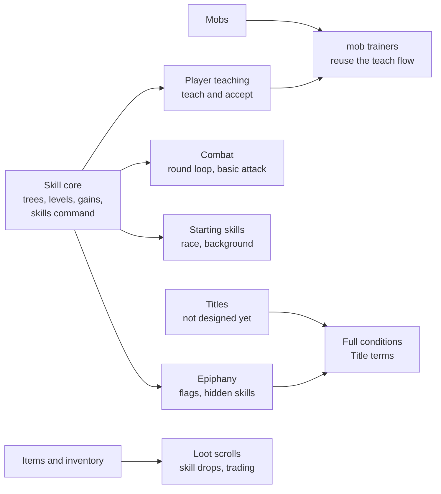

# Skills

[Design summary](README.md) · Status: the skill core and combat are built (trees as data, levels, progression, active, passive and attack skills, starting skills, `skills`, `use`, `autoattack`); trainers, loot tables and discovery through use are built too; teaching between players, epiphany and rarity rules are not

Characters have no class. What a character can do is the set of skills they have learned, organized into skill trees. Every skill improves only by being used; how that works is in [Progression](progression.md).

## Skill trees and skills

A tree is a themed set of skills, and a character has "opened" a tree once they know any skill in it. There is no separate unlock step.

- **Levels.** Each skill has a level from 0, with no cap, each harder to reach than the last (see [Progression](progression.md#skill-levels-have-no-cap)). Reaching its `mastery` level (50 by default) is **mastery**, a milestone. Levels are permanent and never decay.
- **Requirements.** A skill lists the conditions a learner must meet, usually `Skill(id, level)`. They can point into other trees, which is how hybrid skills work. Requirements use the same [condition language](#hidden-skills) as hidden skills, so a skill can also require an attribute, such as Magic 1 for a tradition's foundation casting skill.
- **Requirements make a skill eligible, not learned.** Meeting them only means the character may acquire the skill, through teaching, loot or epiphany.
- **Every skill is worth having for itself** (decided 2026-10-27). No skill is trained only to unlock others: an attack you fight with, a technique or active skill you use, a passive that improves something or reacts, a school that powers your spells. Opening the rest of a tree comes on top. A skill whose only use is leading on to others is a design bug.
- **Skill ids** follow the zone convention: `basics` inside its own tree, `fire:basics` from another tree.
- **Each skill links to an attribute.** A skill's effectiveness is its level plus that attribute (see [Attributes](attributes.md)). Trees set a default `attribute`, and a skill can override it.

Trees live in data files, one per tree, hot-reloaded like zones. The files end in `.skill.ron` so Bevy doesn't mistake them for zone files:

```ron
// assets/skills/swordplay.skill.ron
(
    name: "Swordplay",
    rarity: Common,
    attribute: Agility,
    skills: {
        "basics": (
            name: "Basic Swordplay",
            mastery: 50,
            teach_level: 10,
        ),
        "riposte": (
            name: "Riposte",
            rarity: Uncommon,
            requires: [Skill("basics", 15)],
            teach_level: 20,
        ),
        "flame_blade": (
            name: "Flame Blade",
            rarity: Epic,
            source: Loot,
            requires: [Skill("basics", 30), Skill("fire:basics", 20)],
        ),
    },
)
```

| Field | Default | Meaning |
| --- | --- | --- |
| `name` | required | Display name |
| `description` | required | What players read about it, with `skills <skill>` |
| `text` | required for attacks, techniques, counters and active skills | What everyone sees when it's used; see [Skill text](#skill-text) |
| `mastery` | 50 | Level at which the skill is mastered: a milestone, not a cap (`max_level` is still read) |
| `requires` | none | Conditions the learner must meet |
| `attribute` | the tree's | The attribute added to the skill's level |
| `rarity` | the tree's | Common to Legendary; may be higher than the tree's, never lower |
| `source` | `Trainer` | `Trainer` or `Loot`; see [Acquiring skills](#acquiring-skills) |
| `teach_level` | `mastery` | Level a teacher needs; ignored for `Loot` skills, which always need mastery |
| `kind` | required | `Active(...)` or `Passive(...)`; see [Skill kinds](#skill-kinds) |
| `difficulty` | 1.0 | Multiplier on the gain chance |
| `hidden`, `unlock`, `trigger`, `hint` | off | See [Hidden skills](#hidden-skills) |

## Skill text

Every skill says, in its own file, what it looks like. Nothing about a skill's wording lives in the code, so a new skill can't ship without it.

- **`description`** (every skill) is what players read with `skills <skill>`: what it is and what it does.
- **`text`** is what everyone sees when it's used, as templates: `{actor}` is the user and `{target}` what it's used on, and a command can offer more (a skill aimed at a lock gives `{door}`, one aimed at an item `{item}`, and `{worth}` when it reveals its worth, Pickpocketing `{coins}`, Haggling `{deal}`). Each moment has a line for the user (`actor`), for its target (`target`, when that's someone), for everyone else there (`room`), and, for skills used on doors, for whoever is on the other side (`beyond`). A line that starts with a name gets its capital letter. The game adds only what isn't flavour: the damage count, and conditions like "is bleeding!".
- **`hit` and `miss`:** the moment it works (a blow lands, a lock gives) and the moment it doesn't.

  ```ron
  "kick": (
      name: "Kick",
      description: "A swift kick that lands harder than a punch, for a little stamina.",
      kind: Technique((with: "brawling:basics", cost: Stamina(1), damage: 2)),
      text: (
          hit: (actor: "Your kick {harm} {target}.", target: "{actor}'s kick {harm} you.", room: "{actor}'s kick {harm} {target}."),
          miss: (actor: "You kick at {target}, but miss.", target: "{actor} kicks at you, but misses.",
              room: "{actor} kicks at {target}, but misses."),
      ),
  ),
  ```

- **Damage reads in Diku's words.** Every hit line of an attack or a technique that does damage must hold `{harm}`, filled with how much of the target's health it took ("scratches", "decimates", "MASSACRES"): "Your slash {harm} {target}.", "{actor}'s slash {harm} you." See [Combat](architecture.md#combat).
- **Required where it shows.** Attacks and techniques that strike need `hit` and `miss`, each with a `target` line; a technique that doesn't strike (Guard) needs `hit`; a counter (Riposte) needs `hit` with a `target` line; an active skill needs `hit` and `miss`. A tree with a skill missing any of these doesn't load, and the tests check every tree file, including that each `{placeholder}` is one the game fills in.
- **Passives may have text too,** shown when they decide a moment. **Dodge** has: when an attack misses someone who knows it, they see "You dodge the town guard's attack!" instead of a plain miss. In a dodge's text `{actor}` is the dodger and `{target}` the attacker. Passives with nothing to show (Toughness, auras) have only a description, and ones that fire constantly (Endurance) shouldn't have text.
- **A miss is credited to a defence,** in proportion to how much each adds to the defender's defence, so a big shield more often turns a blow ("The town guard turns your attack aside with a shield!", Block's text) than a sidestep dodges it. Someone with a shield and no Block says so plainly. Parries can join the same way later.
- **Untrained weapons** have no skill to describe them, so the game says it plainly: "You hit the rat."

## Skill kinds

Skills are either active, triggered by the player, or passive, applying automatically. Both progress through use: a passive skill's use is a game event it declares, usually an outcome, such as a dodge that succeeds or mana being spent.

| Kind | How it works | Examples | Counts as a use |
| --- | --- | --- | --- |
| Active | The player triggers it with a command | Riposte, Fireball, Forage | Each activation |
| Passive | Applies automatically: a reaction or a constant bonus | Dodge Mastery, Deep Mana, Toughness, Night Vision | Each time its trigger event fires |

```ron
"riposte": (
    name: "Riposte",
    kind: Active(command: "riposte", target: Enemy, cost: Stamina(3), cooldown: 8),
    requires: [Skill("basics", 15)],
),
"dodge_mastery": (
    name: "Dodge Mastery",
    kind: Passive(triggers: [DodgeSucceeded]),
    attribute: Reaction,
),
"deep_mana": (
    name: "Deep Mana",
    kind: Passive(triggers: [ManaSpent(per: 10)]),   // one use per 10 mana spent
    attribute: Willpower,
),
```

- **Outcome triggers reward doing, not just being there.** Dodge Mastery improves when dodges succeed, not every time the character is attacked.
- **Amount triggers scale with the amount.** `ManaSpent(per: 10)` counts one use per 10 mana, so one large spell counts for more than a trivial one.
- **Two separate cooldowns.** An active skill's use cooldown (Riposte every 8 seconds) is combat balance. The gain cooldown limits how often any skill can level, active or passive.
- **Spells are not skills.** They're known, not levelled, and cast through a magic school, which is a skill (see [Spells](magic.md#spells)). Everything else a character can do, including weapon techniques like Riposte and Cleave, is a skill.
- **What a skill does** (damage, bonuses, applied conditions) needs an effect system, designed together with combat.
- **Combat is made of skills.** There is no attack outside the skill system: everyone starts with a basic attack skill, and weapon trees begin with their own. Mobs fight with skills from their templates, by the same rules as players.
- **Racial abilities are skills too,** usually passive, requiring the race (see [Races](characters.md#races)).
- **Some passives grow with other skills:** `UsedSkill(id)` counts one use whenever that skill is used, `UsedTree` whenever any other skill in the passive's own tree is, and `UsedAttack` whenever any attack skill is (a sword's swing, a punch). The Adept's Inner Discipline has `UsedTree` and `UsedAttack` (see [Magic](magic.md)).
- **Triggers use the shared game events.** Passive triggers, hidden-skill triggers and easter-egg flags all draw on one event vocabulary (see [Architecture](architecture.md#game-events)).

### Invoking active skills

Every active skill is invoked with `use <skill> <target>`. Players make their own shortcuts with aliases, which are a general command feature (already built) rather than part of the skill system:

```
alias fireball use fireball
fireball goblin        ->  use fireball goblin
alias fb use fireball
fb goblin              ->  use fireball goblin
```

- Anything typed after an alias is appended to its expansion.
- Aliases are saved per character, in the `character_aliases` table.
- They cannot shadow built-in commands, so `quit`, `help` and `look` always work.
- An expansion is not expanded again, so aliases cannot chain or loop.
- `alias` lists them, `unalias <name>` removes one; a character can have up to 50, each up to 200 characters.

## Rarity

Both trees and skills have a rarity tier. Rarity says how scarce something is, while `source` says how it can be obtained; the two are set independently.

- **A tree's rarity** governs opening the tree: how often its entry skills drop and how hard they are to find someone to learn from.
- **A skill's rarity** defaults to its tree's and may be raised, never lowered. A common tree can end in a legendary capstone, but a rare tree cannot have a common way in.

Working tiers, pending a decision on names:

| Tier | Drop rate | Mob trainers (proposed) | Shown as |
| --- | --- | --- | --- |
| Common | Frequent | In towns | Plain |
| Uncommon | Occasional | A few, in remote places | Green |
| Rare | Scarce | None | Blue |
| Epic | Very scarce | None | Purple |
| Legendary | Unique drops or quests | None | Gold |

Rarity is not protected by teaching limits. It is protected by time: high-tier skills have high teaching levels or require mastery, and level-scaled gain cooldowns make those levels take weeks to reach. A rare skill therefore spreads only as fast as new masters appear.

Tier rules live in `assets/config/rarity.ron`, hot-reloaded, so drop rates and colours can be rebalanced without a restart.

**Optional, later:** a worldwide cap on how many living characters may know a given legendary skill at once.

## Acquiring skills

Every skill can be taught, and every route checks the same thing: the learner must meet the skill's requirements, plus its unlock conditions if it is hidden. The learner does not need to have opened the skill's tree, so learning from a master is a way into a new tree.

| Route | Available for | Who or what | Notes |
| --- | --- | --- | --- |
| Mob trainer | Entry skills | Trainers placed in rooms, each with a fixed list (`teaches` on the mob template) | **Trainers teach only each tree's entry skill,** the skill with no requirement inside its tree. *Built:* `learn` lists a trainer's lessons and `learn <skill>` takes one, checking the skill's `requires`. Free until there's money. The drill sergeant teaches every weapon's basics and Toughness; each magic tradition's teacher Awakens students with Magic 1 |
| Discovery | Skills above the entry tier | Using any skill in the same tree | Very rare, and free. See [Discovery](#discovery). *Built* |
| Karma | Skills above the entry tier with a Karma price | `karma <skill>`, in a tree the character already has | The sure route that needs no one else. See [Unlocking with Karma](#unlocking-with-karma). *Built* |
| Remote trainer | Higher tiers | A trainer out in the world who teaches only as a quest reward | Planned, with [quests](quests.md): finding the old axeman is easy, earning his lesson is not |
| Player teacher | All skills | A player at the skill's `teach_level`, or at mastery for `Loot` skills | `teach <player> <skill>`, then the student types `accept`; both in the same room |
| Loot | Mostly `source: Loot` | A scroll or tome item; using it teaches the skill and consumes it | Tradeable, so it feeds an economy |
| Epiphany | Hidden skills | The character meets the unlock conditions, and the trigger if one is set | See [Hidden skills](#hidden-skills) |
| Starting | Universal, racial and background skills | Granted at character creation | Backgrounds give everyday skills only, never fighting or magic; see [Races and backgrounds](characters.md) |

### Unlocking with Karma

Karma can force a discovery. *Built.*

- **Each skill names its own price** (`karma: 12` in its `.skill.ron`), so two skills opening at the same level can cost differently: Swordplay's Lunge costs 8 and Riposte 16, both at Swordplay 15. A skill without a price can't be unlocked this way: entry skills, which trainers teach (a price on one is an error at load), and the world's hidden skills.
- **Only in trees the character has:** they must know a skill in its tree. Karma deepens a build; it doesn't open new trees.
- **Requirements still apply.** Karma can bring Cleave at Axes 15 sooner than luck would, but not at Axes 5.
- **`karma`** lists every priced skill in the character's trees, with its cost and any requirement still unmet; **`karma <skill>`** spends the Karma and learns it at level 0 (`learned_via` `Karma`). The Karma is gone for good, and saved with the skill.
- First prices: the journeyman techniques cost 6 to 16 (Kick 6, Lunge 8, Cleave 12, Riposte 16), and the Adept's Killing Hands 10 and Quickened Reflexes 12.

### Discovery

Every use of a skill has a very small chance, **0.1% before Luck**, of revealing another skill in the same tree: one the character doesn't know and whose requirements they already meet. Reaching Axe Fighting 15 makes Cleave and Hew discoverable, and any use of an axe skill might reveal one (*"Something clicks into place. You have discovered Cleave."*). The skill is learned at level 0, marked `Discovered`.

- **Entry skills are never discovered.** They're how a tree is opened, and trainers teach them.
- **Requirements still apply,** including race, so discovery never grants anything teaching couldn't.
- **A [tough fight](progression.md#tough-fights) raises the chance,** up to double, like it does for levels.
- **Hidden skills are separate.** They're found only by epiphany, under their own conditions (below).

**Loot skills spread through masters.** A `Loot` skill enters the world only as a drop. The first owner must reach mastery, through the longest gain cooldowns, before anyone can learn it from them. New loot skills therefore stay scarce for a long time, and their first masters become well known.

## Hidden skills

A hidden skill is learned by **epiphany**: the moment a character meets its unlock conditions, and performs its trigger if it has one, they learn it with a message such as *"Something stirs in you... you have learned Moonlit Step."* Before that, the skill does not appear anywhere.

Unlock conditions are data, built from a small set of terms that other systems share:

| Condition | Met when |
| --- | --- |
| `Skill(id, level)` | The character knows the skill at that level or higher |
| `Stat(name, min)` | An attribute is at least `min` |
| `Title(id)` | The character holds the title |
| `Flag(id)` | A named flag is set on the character |
| `Race(id)` | The character is of that race |
| `All([...])`, `Any([...])`, `Not(...)` | Combinations of the above |

```ron
"moonlit_step": (
    name: "Moonlit Step",
    rarity: Epic,
    hidden: true,
    unlock: All([
        Skill("stealth:basics", 40),
        Skill("nature:herbalism", 20),
        Any([Title("night_wanderer"), Stat("agility", 18)]),
        Flag("drank_from_moon_pool"),
    ]),
    trigger: Some(UseSkill("stealth:basics", in_zone: "forest")),
    hint: false,
)
```

- **Some skills can only be found this way,** behind deliberately stringent conditions: two specific skills at high levels, a title earned, or being in a particular place at a particular moment, like standing in the hidden glade when the full moon rises and the fairy queen appears. These are the world's secrets; no trainer, scroll or discovery leads to them.
- **Circumstance conditions** describe that moment, and are planned alongside the terms above: being in a room or zone (`InRoom`, `InZone`), the time and the sky (`PartOfDay`, and `MoonPhase` once there's a calendar), a mob being present (`MobHere("forest:fairy_queen")`), and world flags (`WorldFlag`, see [World events](world.md)). They are checked when the trigger fires, so a moment can't be prepared in advance and kept.
- **Flags carry the easter eggs.** Any system (a room event, a phrase spoken at an altar, a creature killed, a quest step) sets a named flag, and hidden skills just test for it. New easter eggs need new flags, not changes to the skill system.
- **Triggers are optional.** Without one, the epiphany fires as soon as the conditions are met. With one, it waits for a specific action, which gives players rumours to chase.
- **Teaching never bypasses the conditions.** Hidden skills can be taught like any other, but only to a student who meets the unlock conditions. That makes a master a shortcut past the trigger, not past the conditions.
- **Hints are per skill.** With `hint: true` the tree view shows a `???` slot; otherwise the skill is invisible until learned.
- **Checks are event-driven.** Conditions are re-evaluated only when something they reference changes: a skill level, an attribute, a title or a flag.

## Data

Skill content lives in hot-reloaded RON files and each character's progress in SQLite, the same split as the world.

| Path or table | Contents |
| --- | --- |
| `assets/skills/<tree>.skill.ron` | One tree and its skills, loaded as a `SkillTreeDef` asset; the tree id is the file name |
| `assets/config/rarity.ron` | Drop rates and colours per tier |
| `character_skills` table | `character_id`, `skill` (`tree:skill`), `level`, `practice`, `last_used`, `next_gain_at`, `learned_via` (`Starting`, `Taught`, `Discovered`, `Loot`, `Epiphany`, `Admin`), `learned_at`. Written on every gain and learn, not on every use |
| `character_flags` table | `character_id`, `flag`, `set_at`. The easter egg hook |

- A `Skills` component on each player entity, loaded at login, holds their rows in memory.
- If a skill disappears from the data files, its rows stay in the database and are ignored, so restoring the file restores everyone's progress.

## Build plan

The skill system needs parts of the engine foundation first; see [Architecture](architecture.md#proposed-build-order).



**Skill core scope:** the combat round loop with the basic attack as its first skill, starting skills at character creation, tree files and their hot reload, the `character_skills` table with numbered migrations, the `Skills` component, `roll_skill_gain` with tests and a tuning simulation, a `skills` command, and an admin command to grant skills for testing.

### What's built

The skill core, without combat, proved on non-combat skills first:

- **Trees** in `assets/skills/<tree>.skill.ron`, hot-reloaded: `thievery` (Lockpicking, Pickpocketing) and `athletics` (Endurance) so far. Fields built: `name`, `kind`, `max_level`, `attribute`, `rarity` (shown, not yet enforced), `difficulty`, `requires` (recorded for teaching).
- **Kinds as built:**

  ```ron
  "lockpicking": (name: "Lockpicking", kind: Active(aim: Lock, cost: Stamina(1), cooldown: 2,
      against: "target.pick", effects: [Remove(condition: "locked")])),
  "tracking": (name: "Tracking", kind: Active(command: "track", cooldown: 3)),
  "endurance": (name: "Endurance", attribute: Willpower, kind: Passive(triggers: [StaminaSpent(per: 3)])),
  ```

  An **active** skill either is made of effects, resolved like a spell (First Aid: see [Active skills, as built](effects.md#active-skills-as-built)), or names the command that performs it, for what's like nothing else; `use lockpicking north` runs `pick north`, so `use` stays generic and each skill's work lives with the system it acts on. The command checks the skill is known, off its use cooldown and affordable, pays the stamina, does its work, and counts the use. An active skill whose command doesn't exist yet ("You can't put Pickpocketing to use yet") can still be known and taught.

  A **passive** skill lists [game event](architecture.md#game-events) triggers; `StaminaSpent(per: 3)` counts one use for every 3 stamina spent, so Endurance improves as a character exerts themselves, `Dodged` practises Dodge, `Blocked` practises Block, and `HitInArmour` practises Heavy Armour.

  An **attack** skill is made every round of a fight once chosen with `autoattack` (see [Combat](architecture.md#combat)). It can cost stamina (`cost: Stamina(4)` for a crushing blow); one its maker can't afford falls back to the free basic attack:

  ```ron
  "basics": (name: "Swordplay", description: "...", kind: Attack(), text: (...)),
  ```

  An **aura** skill, held by a mob, makes certain other mobs in its zone fight better while the holder lives: those of a template, or (since 2026-10-27) every mob with a tag, never the holder itself:

  ```ron
  "rat_kings_command": (name: "Rat King's Command",
      kind: Aura(affects: "sewers:sewer_rat", bonus: (attack: 2, defence: 2, armour: 1))),
  "slime_lords_will": (name: "Slime Lord's Will",
      kind: Aura(affects: "slime", bonus: (attack: 1, defence: 1))),
  ```

  A **technique** is a special move made with an attack skill, in place of the auto-attack, through the action queue (`use lunge`); see [Step 1, as built](trees.md#step-1-as-built). Passives can carry stat **bonuses** that grow with level, and **counters** like Riposte.

  Trees so far: `brawling` (everyone's basic attack, a punch), `swordplay` (needs a blade in hand), `beast` (bites and claws, for mobs), `athletics` (Dodge, Endurance) and `thievery`.
- **Effectiveness** is level + the skill's attribute, used in opposed rolls by the [ratio rule](attributes.md#the-ratio-rule). Lockpicking 0 with Agility 3 against an ordinary lock (4) is a 30% chance.
- **Progression** exactly as in [Progression](progression.md), with Luck on the gain roll.
- **Character level and Karma** come from experience, not skill levels (see [Character level and experience](progression.md#character-level-and-experience)). Character level sets each skill's soft cap.
- **Starting skills** from race, background, and the universal list (Brawling, Dodge and Endurance) are granted at login if the character lacks them, so skills added to the data later reach existing characters. Starting skills that don't exist as data yet are skipped.
- **`skills`** lists what a character knows by tree: level, how warmed up it is (cold, warming, warm, hot), its attribute, and how long until it can improve again. Skills whose tree file is gone are listed as forgotten for now, and come back with it.
- **Admins:** `grantskill <player> <tree:skill> [<level>]`.
- **Saved** in `character_skills` on every use and learn.

## Open questions

- [x] **What stops one character learning every tree?** Character level, from deeds, sets a soft cap on every skill, and skills no longer earn Karma: a wide build is possible but slow, since spreading skills doesn't grow the character (see [The soft cap](progression.md#the-soft-cap-skills-and-the-character)).
- [ ] **Does rarity affect power or leveling speed,** or only how a skill is obtained? Leaning: power yes, leveling speed no.
- [ ] **Do rarer skills use more of the cap?** Perhaps a lower soft cap for rarer skills.
- [ ] **Tier names:** the five working tiers, or names that fit the setting.
- [x] **Do mob trainers teach only the lower tiers?** Only the entry tier. Everything above it is discovered through use, taught by players, found as loot, or taught by remote trainers as a quest reward.
- [ ] **What does teaching cost and reward?** Lesson time, gold paid by the student, and something for the teacher (reputation, or Charisma-linked teaching).
- [x] **Auto-attack or explicit attacks?** Auto-attack: once fighting, the character's chosen attack is used automatically each round, practising as it goes, and other skills are used by command. The auto-attack starts as the most basic attack they know, and the player can set it to another attack skill.
- [ ] **Sustained skills?** Stances and auras that are switched on and cost a little over time. Now or later.
- [ ] **Worldwide cap on legendary skills?** Optional, later.
- [ ] **Titles:** needed by `Title` conditions and not designed yet.
