# The living world: spawns, wandering and world events

[Design summary](README.md) · Status: spawns for mobs and items (`Keep` and `Breed`, timed and `AfterDeath` resets, counting by origin, reseeding, container contents, unique items, pack limits, gated spawns), wandering, crowding, world flags and a first slice of world events are built; time-of-day spawns and the rest of the world-event triggers and actions are not.

The world populates itself and changes on its own. Every mob comes from a **spawn** in a zone file, which decides how often it resets and how many it wants. Mobs can **wander**, crowded rooms push them outward, and **world events** fire when the state of the world meets their conditions. There is one spawn model for everything, from a single dragon to a sewer full of breeding rats.

## Spawns and resets

A zone file lists its spawns. Each says **what** it spawns and **where**, **how often** it resets, and **how many** it wants after each reset.

```ron
spawns: {
    "gate_guards": (mob: "city_guard", room: "gate",
        every: Hours(1), refill: Keep(4), wander: Zone(secs: (30, 90))),
    "red_dragon": (mob: "old_red_dragon", room: "lair",
        every: AfterDeath(Days(30)), refill: Keep(1)),
    "sewer_rats": (mob: "sewer_rat", room: "sewers:nest",
        every: Minutes(20), refill: Breed(doubles_every: Hours(4), max: 200, reseed: Days(7)),
        wander: Anywhere(secs: (30, 120))),
    "angorim": (item: "angorim", room: "lair", every: Hours(6), refill: Keep(1)),
}
```

### When a spawn resets

| `every` | Resets |
| --- | --- |
| `Minutes(n)`, `Hours(n)`, `Days(n)` | On a fixed schedule, in real time |
| `AfterDeath(...)` | Once, that long after its last mob dies or its item is taken. The dragon returns 30 days after it is killed; a boss with guards returns only once all of them are dead |

### How many it wants

On each reset, a spawn counts its living mobs, works out how many it wants, and spawns the difference.

| `refill` | Wants after a reset |
| --- | --- |
| `Keep(n)` | `n`: replaces whatever died |
| `Breed(doubles_every, max, reseed, start)` | The current count grown by however much is due since the last reset, at least one more while any survive, never more than `max`. `reseed` is optional; `start` (default 1) is how many there are the first time the world runs |

**Breeding speed is set per spawn,** as how long the group takes to double. That's independent of `every`, which only sets how often new mobs appear:

| Spawn | Doubles every | Max | Reseed |
| --- | --- | --- | --- |
| Sewer rats | 4 hours | 200 | 7 days |
| Meadow rabbits | 8 hours | 60 | 2 days |
| Forest wolves | 5 days | 12 | 30 days |
| Cave trolls | 30 days | 4 | none |

Growth slows as a spawn nears `max`, so a nearly full nest fills in gradually rather than jumping to the cap.

**Last one standing.** When a breeding spawn's last mob dies, breeding stops, and the `reseed` timer starts. When it ends, a single new mob appears at the spawn and breeding resumes. Clearing out the sewer rats buys the city a week of peace, then one rat appears in the nest and it starts again. Without `reseed`, a breeding spawn that's wiped out stays gone (until a builder uses `spawn reset`).

**The population survives restarts.** A breeding spawn's count is saved whenever it changes (`spawn_counts`), so after a restart the same number come back, all at the spawn, and crowding spreads them out again within a minute. The reseed timer is saved too.

### Counting by origin

Every mob a spawn creates carries a tag naming its spawn, `SpawnedBy("sewer_rats")`. A reset counts tagged mobs **anywhere in the world**, not just in the spawn room.

- **Wanderers still count.** A guard patrolling the market counts toward the gate's spawn, so an empty gate doesn't produce extra guards.
- **No spawn farming.** Luring mobs away from their spawn point doesn't make it refill.
- **Triggers can count a spawn** the same way, for world events (`Count("sewer_rats", ">=", 150)`).

### Items

Item spawns use the same model, naming an `item` instead of a `mob`:

```ron
"practice_swords": (item: "practice_sword", room: "training_yard", every: Minutes(30), refill: Keep(2)),
"cellar_chest": (item: "oak_chest", room: "guild_cellar", every: Hours(1), refill: Keep(1),
    contents: ["bread", "bread", "waterskin", "torch"]),
```

- **A spawned item belongs to its spawn until a player touches it;** from then on it is a [real item](items.md#what-survives-a-restart) and no longer counts, so the next reset spawns a fresh one. Take a practice sword and drop it again, and the yard has three until someone tidies up.
- **Fixed items stay counted.** A chest or signpost can't leave its room, so a real one lying in its spawn room still counts. A chest made real by a player putting something in it is restored after a restart, and its spawn doesn't add a second.
- **Containers are topped up on each reset** from `contents`, a list of item templates (a template listed twice keeps two). Only what's missing is added: anything a player put in stays, and doesn't count against the list. Locked chests are filled too.
- **[Unique items](items.md#unique-items) are never made twice:** their spawn checks for a copy in play or a real one anywhere in the database.
- **Items don't breed, wander or crowd,** and a restart makes untouched spawned items fresh.
- **A removed spawn takes its untouched items with it,** like its mobs.

## Wandering

Each spawn says how far its mobs may roam and how often they move.

| `wander` | Moves |
| --- | --- |
| `Never` (the default) | Stays in its spawn room |
| `Rooms(rooms: [...], secs: (min, max))` | Among the listed rooms, like a dog in the market |
| `Zone(secs: (min, max))` | Anywhere in its zone, like a city guard |
| `Anywhere(secs: (min, max))` | Anywhere, including other zones |

- **Each mob moves on its own random interval,** `min` to `max` seconds, so a room's goblins don't all move in the same tick. Each move picks a random open exit it's allowed to take, rolled through [`Dice`](attributes.md#the-dice-service). Mobs don't open doors yet.
- **Rooms can refuse wanderers** with a `no_wander` flag: temples, shops, players' homes.
- **A puppeted mob doesn't wander.** While a GM or admin [puppets](architecture.md#game-masters-and-puppeting) it, it only moves when they move it.
- **Wanderers move like players, because they use the same command.** A wanderer chooses where to go, and walks there with `go`, as a player would: terrain costs it stamina (a tired mob waits until it's recovered), it leaves tracks, and rooms see "The stray dog leaves east." from the same `Left` and `Entered` [game events](architecture.md#game-events), so triggers and passive skills see mob movement too.

## Mob templates

Mobs are templates in a zone's `mobs`, like items:

```ron
mobs: {
    "sewer_rat": (
        name: "a sewer rat",
        keywords: ["sewer", "rat"],                                   // default: the words of the name
        here: "A sewer rat scurries along the edge of the channel.",   // default: "A sewer rat is here."
        description: "A fat, filthy rat as long as your forearm...",  // what `look rat` shows
    ),
},
```

Rooms show each mob's `here` line, with repeats counted (`(x8)`), and `look <direction>` shows who's there.

Mobs fight by the same rules as players (see [Combat](architecture.md#combat)), with what their template gives them:

```ron
"sewer_rat": (
    name: "a sewer rat",
    race: "human",                   // one of the peoples: its race's attributes and skills
    attributes: {Body: 1, Strength: 1, Agility: 4, Reaction: 4},   // the rest at the base, 3, shifted by race
    skills: {"beast:bite": 2},       // levels; mobs don't improve
    attack: "beast:bite",            // without one, a weapon in hand, then Brawling
    equipment: ["rusty_knife"],      // item templates: worn if wearable, else held (two hands)
    loot: [[(None, 70), ("rat_tail", 30)]],  // one find per table, weighted, with the killer's Luck
    harvest: {"hide": [("rat_pelt", 1)]},    // cut from its corpse, by kind: Skinning, Butchering
    health: 3,                        // instead of 8 + Body / 2; Toughness still adds to it
    tactics: 25,                      // % chance a turn to use a combat skill instead (default 25)
    aggressive: Always,               // attacks players in its room, with `kill`; `Home`: only in its own
    tags: ["vermin"],                 // what it is, for others' allies
    allies: ["vermin"],               // with allies, attacks anyone here who isn't one, mobs too
    avoids: ["slime"],                // never wanders into a room holding one
    conditions: [(condition: "hidden", strength: 8)],   // born with, until something ends them
    traits: ["skittish"],             // what it is, for good (assets/traits/)
),
```

**A mob can be territorial,** `aggressive: Home` (*built* 2026-10-29, [#25](https://github.com/Foxworks-Studios/riftward/issues/25)): it attacks only in the room it was made in, its spawn's, and lets you pass anywhere else. The bear savage in its cave, harmless met on a path. `Always` attacks wherever it is; without `aggressive`, a mob only fights back.

**A mob can avoid others,** `avoids: [...]` (*built*, 2026-10-27): by tag or template, as `allies` are. Wandering, crowding and fleeing (out of a fight or in one, while another way is open) never take it into a room holding one; nothing else changes, so a rat that avoids slimes still goes for guards and players. It keeps rats from draining into the slimes' tunnels ([the sewers](riftwatch.md#the-sewers-ecology)), and will keep deer out of the wolf den. The zone test checks each name.

**A mob can be a thing,** the `inanimate` trait (*built*, 2026-10-27; a template flag until traits came the same day): a training dummy. It takes blows and never acts in a fight (no blow back, no flight, no skill), never wanders or picks one, is worth no experience and gives no tough-fight boost to learning, and leaves no corpse, what it held falling where it stood. It reads as a thing: battered and coming apart rather than hurt, knocked to pieces rather than killed. Its spawn puts it back.

**A mob has traits,** `traits: [...]` (*built*, 2026-10-27): what it is, for good, as opposed to what's happening to it: skittish prey, a thing, a slime's rubbery body ([Traits](effects.md#traits)). Its race's traits come with it. Nothing cures them, and death doesn't clear them. The zone test checks each is a real trait.

**A mob can be born with conditions** (*built*, 2026-10-27): `conditions: [(condition, strength)]` on its template, put on as it spawns and lasting until something ends them (a cure, a `Remove`, or for `hidden`, being noticed and acting). A grey slime born proof against blades, a regenerating Slime Lord, a spider born `hidden` in its web, unseen until someone notices it as they come in. **An aggressive mob unseen by its prey springs from hiding** (*built* 2026-10-29): "The forest spider springs at you from hiding!", and that first blow can't be dodged or blocked, as a Backstab from hiding can't. Blows struck, it's seen. Out of a fight for `rehide_seconds` (`rules.ron`, a minute), a mob born hidden hides again, as well as it was born and seen by no one: "The forest spider slips back out of sight." The zone test checks each condition exists.

**A mob can be one of the peoples,** with `race`: its attributes start from that race's (the template's own ratings win where it sets them), it has the race's skills, `look` says "The provisioner is a human.", and its tracks read "a human", as a player's do. Riftwatch's townsfolk are mostly human; the tinker is a dwarf, the drill sergeant an ork, the magister an elf. Beasts have no race. The zone test checks every race exists.

Mobs use equipment as players do: a mob holding a sword fights with it (and its Swordplay), its weapon techniques work, and `look` shows what it holds and wears. When it dies, its gear falls into its corpse, with one find from each of its **loot tables**: weighted, ordered worst to best, rolled with the Luck of whoever struck the killing blow, `None` for nothing. Sewer rats sometimes leave a tail; the Rat King leaves a tail or his tooth, and sometimes a healing draught.

Mobs take, carry and give items as players do (`get`, `give`, `put`; *built* 2026-10-28, [#55](https://github.com/Foxworks-Studios/riftward/issues/55)), when a builder puppets them or a quest has them hand something over. What a mob holds isn't saved: it resets with the mob and falls in its corpse ([Items](items.md#what-survives-a-restart)). Mobs choosing for themselves to pick things up or use them is still to come.

Mobs share players' vitals and recover by the same rules, at their own maximums: out of a fight, a hurt or winded mob gets its health and stamina back. Mobs use their skills the way players do. Besides its auto-attack, a mob uses the other combat skills it knows (technique skills like Cleave or Guard, spells, and active skills made of effects, like First Aid): each turn, with its `tactics` chance, it uses one it can right then and that would do some good, picked at random, in place of its auto-attack. A technique needs its attack ready and the stamina; a heal, being below half health; a condition, a target that doesn't have it yet; an active skill, being ready and anything it uses up to hand (a bandage). Openers like Backstab are for starting fights, so a mob already in one never picks them, nor what makes no sense mid-fight: hiding, stealing, finding or reading things.

### Rift-touched mutations (planned)

Noted 2026-10-27. Now and then, instead of an ordinary mob, something more monstrous spawns: a creature mutated by the rifts' energy. A sewer rat the size of a dog with too many eyes; a wolf whose fur crackles. Rare enough to be an event, worth a contract, and a little randomized, so no two are quite alike.

- **Built on traits:** a mutation is mostly a trait or two put on at spawn ([Traits](effects.md#traits); decided 2026-10-27, they were conditions it's born with) (resistances, a reaction, regeneration, more health), plus a name and a line that show it: "a rift-twisted sewer rat, its eyes glowing faintly".
- **A pool of mutations, as data** (`assets/mutations.ron`): each with its words (an adjective for the name, a line for `look`), its traits, shifts to attributes and health, a vitae crystal it leaves where it dies (loot, what the rift left in it), and what extra its corpse yields to harvesting (a mutated gland): reagents for later crafts. A mutated mob rolls one, now and then two, from the pool, so they combine.
- **How often:** a small chance on every spawn (first guess 1 in 200), higher the nearer the rifts: the Rift-Scar, the undercity. Places could say how rift-touched they are, which ties to the [setting](riftwatch.md#open-questions) once it's decided.
- **Who:** beasts and slimes by default; a template can opt out (the townsfolk), or carry mutations of its own that only it can take (a slime that splits into more slimes).
- **Fair warning:** `look` and the room line show it, so a player sees what they're walking into.
- **The rift-touched stag** of the Darkwood becomes the first designed one: a stag with a fixed mutation, not a rolled one.

### Mobs fighting mobs

*Built* (2026-10-27). A mob template can say what it is, `tags: ["vermin"]`, and who an aggressive one leaves alone, `allies`: tags, templates (`sewer_rat`, `zone:mob`) or `players`, and always its own kind. With `allies`, an aggressive mob attacks anyone in the room it has noticed who isn't one, mobs as well as players; without, it attacks players only, as before. Or it can name who it goes for, `enemies`, the same way (*built*, 2026-10-30): then it attacks only those, whatever its `allies`, which then say only whose calls for help it answers.

```ron
"town_guard": (
    name: "a town guard",
    tags: ["townsfolk"],
    allies: ["townsfolk", "players"],   // any stranger to the town, a rat or worse
    aggressive: Always,
    ...
),
"sewer_rat": (
    tags: ["vermin"],
    allies: ["vermin"],                 // players, and the guards and dogs of the town
    aggressive: Always,
    ...
),
"stray_dog": (
    tags: ["townsfolk"],
    enemies: ["vermin"],                // rats only; no allies, so it answers no one's call
    aggressive: Always,
    ...
),
```

- **In Riftwatch** every townsperson is `townsfolk`, and the guards are aggressive towards anything that isn't, so when the rats break out the guards and the stray dog fight them. The dog goes for `vermin` alone, as its `enemies` (since 2026-10-30), and counts no one an ally, so it stays out of the guards' fights. The rats and the Rat King are `vermin`, aggressive to everyone else.
- **The same rules as against a player:** a fight is picked as `kill` picks one (`attack` in `combat/mod.rs`), only on someone noticed, and a spawn's `pack` limits how many gang up on one.
- **Kills:** a mob killed by a mob gives no one experience, and its coins stay in its corpse; only a player's kill takes them.
- **The zone test** checks every ally and enemy is `players`, a mob template, or a tag some mob has.
- **Guards are meant to be deadly** (decided 2026-10-30): picking a fight with the law is a mistake, not a challenge. A town guard is a match for a character of level 8 and kills a new one, often in a round (a level-6 character wins one fight in ten); six walk the town, and Call for Help brings the rest down on anyone strong enough to win against one. The keep's own guards are a match for level 12. Checked with `balance_town` ([the balance tool](riftwatch.md#tuned-against-new-characters)).
- **Reinforcements** (*built*, 2026-10-27): a guard losing a fight shouts for help, and those nearby who count them an ally come running. It's the Command tree's **Call for Help** (`command:call_for_help`), a passive whose reaction, on dropping below half health, is `CallForHelp(rooms: 2)`: allies within two rooms, through exits anyone could walk (open doors, no climbing), who aren't fighting, dead or being played, walk in (seen arriving, as anyone walking in is) and join the fight against the caller's foe, a player too. An ally is the caller's own kind or one its `allies` name (`MobDef::allied`, stricter than `spares`: without `allies`, only its own kind); so a guard's call brings the other guards, the keep's guards among them, but never a rat, and not the stray dog, which has no `allies` and so answers only other stray dogs (decided 2026-10-30: it keeps out of the guards' business). Town and keep guards know it. `combat/help.rs` answers the calls.

## Building mobs and spawns

| Command | Does |
| --- | --- |
| `mob` / `mob <id>` | List this zone's mob templates, or show one |
| `mob new <id> <name>` | Create a template |
| `mob <name\|here\|desc\|keywords> <id> <value>` | Edit one (`mob here <id> none` restores the plain line) |
| `spawn` / `spawn <id>` | List this zone's spawns with how many are alive, or show one |
| `spawn new <id> <mob\|item> [<count>]` | Add a spawn in this room, of a mob or item template: keeps `count` (default 1), resets every 10 minutes, doesn't wander |
| `spawn count <id> <n>` | Keep `n` (a breeding spawn becomes a keeping one) |
| `spawn breed <id> <doubling> <max> [<reseed>]` | Breed: `spawn breed sewer_rats 4h 200 7d` |
| `spawn crowd <id> <n\|none>` | How many of its mobs a room holds before they push outward |
| `spawn reset <id>` | Reset it now, whatever its timers say: refill, grow, or bring back a wiped-out spawn |
| `spawn every <id> <10m\|2h\|1d\|death 30d>` | How often it resets. A new schedule starts at once |
| `spawn wander <id> never` / `zone <min> <max>` / `anywhere <min> <max>` / `rooms <min> <max> <room>...` | How far its mobs roam, and how often they move, in seconds |
| `spawn mob <id> <mob>` / `spawn item <id> <item>` / `spawn room <id>` | Change what it spawns, or move it to this room |
| `spawn contents <id> <item>... \| none` | What an item spawn's container is topped up with on each reset |
| `spawn remove <id>` | Remove the spawn and its mobs |
| `summon <mob>` | Bring a mob here that belongs to no spawn, for testing: by its template id (`stray_dog`, `riftwatch:stray_dog`) or the words it answers to (`dog`), this zone first, then every zone |
| `purge [<mob>]` | Remove a mob here, or every mob here. Its spawn refills at its next reset |

Rooms can be flagged with `flag <indoors|no_wander> <on|off>`, or in the zone file. `no_wander` turns wanderers away; Riftwatch marks its shops, the shrine and the guild's quieter rooms. `indoors` hides the sky, so dawn and dusk pass unannounced; the sewers and the town's halls are indoors.

## Terrain

Every room has a `terrain` saying what its ground is like, and walking into a room costs that terrain's stamina:

| Terrain | Stamina | For |
| --- | --- | --- |
| `Paved` (the default) | 0 | Streets and floors |
| `Road` | 0 | Roads |
| `Uneven` | ½ | Sewer walkways, forest tracks, rough grass |
| `Rough` | 1 | Rubble, scree, steep slopes |
| `Mud` | 1½ | Mud |
| `Wading` | 2 | Water up to the waist |

- **Carrying too much doubles it,** and makes even paved ground cost ½: being encumbered is now felt on every step.
- **Without the stamina, you can't go:** "You're too exhausted to wade in. Rest a while." Paved ground and roads are free, so no one is ever stranded in a town.
- **Fleeing pays its own way** (2 stamina, see [Combat](architecture.md#combat)) rather than the terrain's, so a fight can always be escaped while there's stamina for it.
- **Walking practises Endurance,** like any stamina spent, so long treks build it.
- **Builders** set it with `terrain <kind>`, or in the zone file. The sewers are uneven, with rough rubble in the Collapsed Gallery and the Warren and waist-deep water in the Flooded Tunnel, Overflow Chamber and Drowned Stair; the Darkwood's roads are roads, and the track to the Hermit's Clearing is uneven.
- **Terrain sets how well tracks read** (see [Tracking](#tracking)): mud is easiest, then uneven ground, rough ground, roads and paving; wading water holds none.

### Climbing and swimming

An exit can need a climb or a swim, written in its long form: `"down": (to: "ravine", needs: Climb(4))`, alone or with a door.

- **Crossing is a roll:** Climbing plus Strength, or Swimming plus Body, against the exit's difficulty, by opposed roll (the [ratio rule](attributes.md#the-ratio-rule)), with Luck. Anyone can try on their attribute alone; only the trained practise.
- **A failed climb is a fall** (2026-10-29): climbing down, you fall to the bottom, landing in the room below; climbing up or across, you fall back where you began. Either way you go on falling through any open drop beneath (a `down` exit that needs a climb, with no closed door), and each room fallen through hurts `fall_damage_per_room` (`rules.ron`, 1d6 each), so a longer fall hurts more: one room 1 to 6, two rooms 2 to 12. **A fall can kill:** you die where you land, your own killer, so no one gains by it; a mob that falls to its death counts as dying, for quests and world events. "You lose your grip and fall! You hit the ground hard. (3)" Whoever's below sees "Ada falls from above and lands hard!", and followers don't fall after you.
- **A failed swim keeps you where you are,** and costs half the difficulty in stamina. The room sees either ("Grok tries to climb down, and falls.").
- **Mobs never wander, and no one flees,** through an exit that needs a climb or a swim.
- **The wording** is the skills' own (see [Skill text](skills.md#skill-text)): `{direction}` is the exit.
- **Places today:** the Darkwood's East Road climbs down to the Ravine Floor, where moonpetal grows thick (Climb 4, each way); the sewers' Drowned Stair swims down to the Sunken Hall, under the city, where a silver locket and a healing draught wait (Swim 4, each way); the Stones' Hill climbs out of the deep wood to the Old Standing Stones (Climb 5, each way).

### Getting lost

*Built* (2026-10-29). A room can be `tangled: n` (none, the default, is never): leaving it, a player rolls Navigation (Survival) plus Intuition against `n`, by the [ratio rule](attributes.md#the-ratio-rule), with Luck. Anyone can try on Intuition alone; only the trained practise.

- **Lost, you go out another way** than you meant, picked at random from the room's plain exits: never through a door you don't know or that's shut, nor over a climb or a swim, so getting lost never drops you off a cliff. A room with no other way out can't lose you. You're told, in the skill's words: "You set off north, but the trees close in, and you feel like you're getting turned around." Then you see where you've ended up.
- **Mobs never lose their way** (they know their woods), and nor does someone fleeing, who runs blind anyway.
- **A compass** (the hunter's, 15 gold: more than a steel breastplate, a goal to save for across several contracts) gives `bearings` while carried, `Skill("survival:navigation", 4)`. The [same modifier](effects.md#modifiers) works for Climbing and Swimming. With base Intuition (3), the odds of going astray:

| `tangled` | Untrained | Compass | Navigation 3 | Navigation 3 and a compass |
| --- | --- | --- | --- | --- |
| 1 (a trail, near a landmark) | 4% | under 1% | under 1% | under 1% |
| 2 (the wood between) | 23% | 2% | 4% | under 1% |
| 3 (Moss Hollow, the Thorn Tangle) | 50% | 7% | 11% | 3% |

- **Places today:** the deep wood, its landmarks (the Fallen Giant, the Stream Bend) and caves never, its trails 1, the wood between 2, Moss Hollow and the Thorn Tangle 3.

### Tracking

Every room remembers the tracks of whoever walks in or out, player or mob, for 30 minutes, up to 20 of them (`tracks` in `assets/rules.ron`, with the ground difficulties and age words below), the oldest going first. A teleport leaves none, wading water holds none, and they aren't saved.

- **`track [<who>]`** reads them with Tracking (Intuition): each track is found by your skill against the ground's difficulty (mud 1, uneven 3, rough 5, road 6, paved 8), which doubles every ten minutes of the track's age. `track rat` reads only tracks whose maker matches.
- **Tracks show what made them, not who:** "a sewer rat headed west (fresh)", "a human came in from the south (old)". Your own tracks aren't shown. Ages read as fresh (under 5 minutes), recent (under 15) and old.

### Environment and finds

Separately from its footing, every room has an **environment**: what kind of place it is, and so what can be found there. A road through the Darkwood is forest to forage and road to walk.

| Environment | Rooms today |
| --- | --- |
| `Town` (the default) | Riftwatch: nothing to gather |
| `Forest` | The Darkwood |
| `Field` | The west woods' stump field and meadows |
| `Water` | The west woods' brook ford and reed pool |
| `Cave` | None yet |
| `Sewer` | The sewers |

- **A zone says what each environment yields** in its `finds`, and a room can have its own instead. Each is weighted tables by kind, ordered worst to best: `"forage"` for Foraging, `"herbs"` for Herbalism, and any other kind a skill `Find`s ([Every skill as data](effects.md#every-skill-as-data)). `None` is nothing at all. The zone test checks every item in them exists.

  ```ron
  finds: {
      Forest: {
          "forage": [("wild_berries", 50), ("mushrooms", 35), ("hazelnuts", 15)],
          "herbs": [("yarrow", 50), ("kingsfoil", 35), ("moonpetal", 15)],
      },
  },
  ```

- **`forage` and `gather`** (shortcuts to `use foraging` and `use herbalism`) search the room (see [Gathering](trees.md#gathering)). Each room holds three finds of each kind, and grows one back every 10 minutes (`finds` in `assets/rules.ron`), so no one strips one bush forever. Finds aren't saved: a restart lets everything grow back.
- **Builders** set a room's environment with `environment <kind>`, or in the zone file; a room dug out of another takes its environment.

### Light and darkness

*Built* (2026-10-29). Every room is lit one of three ways, set in the zone file (`light: Dark`) or with the builder `light` command:

| `light` | Lit |
| --- | --- |
| `Daylight` (the default outdoors) | By the sun: dark at night |
| `Lit` (the default indoors) | Always: lamps nobody needs to see |
| `Dark` | Never, but by what's brought in: caves, the deep wood. A room dug out of a dark one is dark too |

- **Light sources are items tagged `light`:** lying in the room (Riftwatch's iron lampposts, the hunter's campfire, a dropped torch) or carried by anyone there, at any depth (a torch, later a lantern). Carried means lit for now; lighting, putting out and burning down come with item decay.
- **In a dark room, someone who can't see in the dark is `in_the_dark`** (a condition the light system puts on and takes off as the light changes): `look` shows only the exits ("It's too dark to see. You can feel your way to the exits."), they see no one (so they can't target anyone, nor aim a spell or skill at anyone but themselves, and a blinded mob picks no fights), and they fight blind, attacking and defending at half. A glimpse into a dark room shows no one.
- **Seeing in the dark** is a `SeesInDark` modifier: the dwarves' and trolls' Heat Sight (a racial trait), and night eyes on the west woods' beasts, so at night the woods belong to them and a traveller wants a torch.
- **Riftwatch at night:** lampposts light the gate, the market and stalls, the herbalist's and tinkers', Guild Row, High Street, the garrison and training yards, and the keep's gate and courtyard. The back alley, the archery butts and the watchtower go dark. Indoor rooms stay lit. **The sewers are dark** (decided 2026-10-29): every room is `light: Dark`, and everything living down there has night eyes, so going down without a torch means fighting rats you can't see, at half. Harwin sells torches, and the Guild Cellar chest holds one.

### Room conditions

*Built* (2026-10-29). A place can have conditions of its own, for good, as a mob is born with them: brambles, webs, a rift's hum. They're the same [conditions](effects.md#conditions) as on characters, in `assets/conditions/places.conditions.ron`, listed on the room in its zone file:

```ron
"bramble_thicket": (..., conditions: [(condition: "brambles", strength: 1)]),
```

- **Their reactions answer whoever is there:** `Enters`, whoever comes in; `Gathers`, whoever forages or gathers there (a honey tree's `angry_bees` sting half the time) (the brambles: `Damage`, "A bramble grazes you as you push through."), and `Every(Minutes(n))`, everyone there every so often (the Rift-Scar's `rift_hum`). A `chance` makes it a maybe (webs catching you). The place has no hands, so a reaction is resolved as the one it happens to's own: its `actor` line to them, its `room` line to the rest, through armour and resistances like any reaction. A ward or an immunity is what keeps it off.
- **`look` shows them,** by their `looks` line: "Brambles snag at everything here, thick and thorny."
- **Light:** a place's condition can light it whatever the hour (`Lights`: a rift's glow) or darken it past any light (`Darkens`: magical dark no torch pierces, though Heat Sight still sees). See [Light and darkness](#light-and-darkness).
- **The zone test** checks each is a real condition. There's no builder command for them yet: they're set in the zone file. Effects that put a condition on a room (a fog, a ward on a doorway) come later.

### Ambient lines

*Built* (2026-10-29, [#24](https://github.com/Foxworks-Studios/riftward/issues/24)). A little life between fights: a mob template or a room can have `chatter`, lines one of which now and then reaches the players there.

```ron
"crow": (..., chatter: ["A crow caws from a high branch.", "A crow shifts on its perch and watches you with one black eye."]),
"north_trunk": (..., chatter: ["Water drips somewhere in the dark."]),
```

- **A room with a player in it says one about every `chatter_minutes`** (`assets/rules.ron`, first guess 1.5), picked from its own lines and those of the living mobs there that aren't hidden: a hidden spider says nothing. Rolled through `Dice`, from elapsed time.
- **Repeats are rare, not random** (decided 2026-10-29): each room remembers what it said. A line just said has the least weight (1), and every line passed over gains one each time another is said, up to 5, as a line never said has. So every line comes round, and the same one twice running is about one in eleven with three lines, not one in three.
- **Today:** crows in the woods, the stray dog in the market, rats squeaking in the sewers, birdsong in the Deer Meadow, dripping in the North Trunk, hawkers in the market. The Rift-Scar's hum is the scar's.

### Weather (planned)

Weather, with the time system, will change the ground. A room can say what it becomes when wet, `when_wet: Mud`, so a dirt road turns to mud in the rain and is exhausting to trudge through until it dries. Rain would come and go by zone, announced to everyone outdoors like dawn and dusk, and dry out over some game hours afterwards.

## Doors

Status: built, except door resets. Hidden doors are built (2026-10-29). Doors open, close, lock and unlock (with their key), and can be picked and bashed.

Exits keep their short form, `"west": "square"`. A longer form adds a door, defined once in the zone and named by both sides, so opening it from one room opens it from the other:

```ron
doors: {
    "cellar_door": (name: "a heavy oak door", state: Locked,
        lock: Some((key: Some("cellar_key"), pick: Some(4), bash: Some(5)))),
    "trapdoor": (name: "a trapdoor"),                     // closed, no lock
    "bookcase": (name: "a bookcase", keywords: ["bookcase", "shelves"], hidden: true),
},
rooms: {
    "tavern": ( ..., exits: { "west": "square", "down": (to: "cellar", door: "cellar_door") } ),
    "cellar": ( ..., exits: { "up": (to: "tavern", door: "cellar_door") } ),
},
```

- **The lock is the shared [lock model](items.md#locks-and-keys):** open, closed or locked; keys, `pick` and `bash`. Doors are targeted by direction first (`open north` → "It's locked.") or by name (`open door`, `open trapdoor`).
- **Keywords** default to the words of the name without its article, so "a heavy oak door" answers to `heavy`, `oak` and `door`.
- **A trapdoor is just a door on an `up` or `down` exit.**
- **Doors between zones** use `zone:door` names on both sides.
- **A closed door blocks movement** for players and wandering mobs: `north` gives "The heavy oak door is closed." Mob templates can be allowed to open doors, such as a guard who carries the gate key. A packed crowd can [break through](#breaking-out).
- **Rooms show door state:** "Exits: west, down (closed)", and `look down` describes the door.
- **`bash` only forces a door open.** It isn't broken; it can be closed and locked again.
- **Doors reset with their zone,** back to their default state, so the cellar is locked again after the next reset (once resets exist). Door state isn't saved across restarts.

### Building doors

| Command | Does |
| --- | --- |
| `door <dir> <name>` | Add a closed door with no lock to that exit (and to the exit back, if there is one), or rename the door already there |
| `door <dir> lock` | Give it a lock (pick 5, bash 10, no key yet) that starts locked |
| `door <dir> nolock` | Remove its lock |
| `door <dir> open` / `closed` | Set whether it starts open or closed |
| `door <dir> hidden <n>` / `visible` | Hide the door, found with `search` against `n`, or show it again |
| `door <dir> remove` | Remove the door from both sides |
| `door <dir>` | Show the door: id, how it starts, its lock |

The door's id comes from its name (`a heavy oak door` → `heavy_oak_door`). Changing how a door starts takes effect at once, and `link` and `unlink` refuse to touch an exit with a door until it's removed.

### Hidden doors

*Built* (2026-10-29, [#9](https://github.com/Foxworks-Studios/riftward/issues/9)). A door with `hidden: <n>` (how hard it is to find) isn't in a room's exits **for each character until that character finds it**. To someone who hasn't found it, the exit doesn't exist: it isn't listed, "You can't go that way.", `look` that way sees nothing, it can't be opened, picked or bashed, and no one flees through it.

- **Finding** is `search`: the searcher's Intuition, doubled for a deliberate search (`search_bonus`), against `n`, by opposed roll with Luck, for each hidden door out of the room they haven't found. "You find a pair of iron-banded doors, hidden to the north!" A search finds hidden people and doors at once.
- **Found doors are remembered per character,** as a `char.` [fact](facts.md) (`found_door:riftwatch:bookcase`), so they stay found across resets and restarts, from both sides of the door. Other players still have to find it themselves.
- **Mobs know every door,** hidden or not: a smuggler uses his own way out.
- **Builders see them,** marked "(hidden)" in the exits, and hide or show one with `door <dir> hidden <n>` and `door <dir> visible`.
- **Later:** finding one when a condition is met (`reveal_when: WorldFlag("lever_pulled")`), and a searching skill adding to the roll.

## Crowding

A spawn can set how many of its mobs one room holds comfortably (`crowd: 6`). Its mobs then stay put at their wander checks while their room holds that many or fewer. Past that, the extras move on, each toward the neighbouring room within its wander range that holds the fewest of its kind (a random one among equals). A spawn without `crowd` wanders as usual, moving at every check.

So the nest fills to its limit, then rats spill into the next rooms, which fill in turn, and the population pushes outward as it grows. They leave through open exits, and through closed doors only by breaking them (below).

### Breaking out

*Built* (2026-10-26). A crowding spawn can set `breach`: when a room holds `packed` of its mobs, and what lies beyond a closed door holds fewer of them than every open way, the next to move breaks the door and goes through. A door that's only shut gives way, as does a locked one whose lock can be bashed; one too sturdy to bash holds. It's left open, and anyone can close it again, until the crowd breaks it again.

```ron
"sewer_rats": (
    ...
    crowd: 6,
    breach: Some((
        packed: 8,
        room: "{actor} gnaws through {door}, and the rats pour after it!",
        beyond: "{door} gives way with a screech of rusted iron, gnawed through from below!",
    )),
),
```

- **The wording is the spawn's:** rats gnaw, goblins might batter. `{actor}` is the mob, `{door}` the door; `room` is seen where they are, `beyond` on the other side.
- **Only under pressure:** a door is broken only when beyond it is emptier than every open way, so rats fill the tunnels around a grate before they gnaw through it. The zone test checks that a breach comes with a `crowd` below its `packed`.
- **How long a neglected sewer holds:** with rats doubling every 4 hours from 8, and the nearest grate (the stalls culvert) four rooms from the Warren, the region around it fills to 8 a room in roughly 10 to 11 real hours from a fresh start; sooner once the population has grown, since it's saved across restarts. Door states aren't, so a restart shuts every grate.

Crowding plus breeding is how a neglected sewer overruns the city, with no special rule:

```mermaid
flowchart LR
    breed[Rats breed<br/>in the nest] --> crowd[Nest crowded]
    crowd --> spread[Rats disperse<br/>through the sewers]
    spread --> packed[Packed under a grate:<br/>they gnaw through]
    packed --> streets[Anywhere wander<br/>reaches the streets]
    streets --> event[Trigger: rat count high<br/>town crier warns, guards posted]
    kill[Players clear them] --> fewer[Fewer rats breed]
    fewer --> last[Last rat dies]
    last --> reseed[A week later,<br/>one rat in the nest]
    reseed --> breed
```



## Packs

A spawn can set `pack: n`: the most of its mobs that will fight **any one target** at once. The limit is per target, not in total: each mob goes for the next one it has noticed who has fewer than `n` of its spawn on them, so eight rats with `pack: 2` attack four people two apiece. Only when every target has its share do the rest wait their turn, and the next steps in when one dies. Sewer rats have `pack: 3`, so a crowded Warren is a stream of fights for one adventurer rather than a swarm, and a group walking in meets three rats each; wolves might hunt with `pack: 3`.

## Gated spawns

A spawn with `when` only fills while its requirement holds, in the shared [requirement language](facts.md#one-requirement-language): `when: WorldFlag("rats_broke_out")`. While it's false the spawn is left alone entirely. This is how the Rat King appears only after a breakout. With `when: TimeOfDay([Dusk, Night])` a spawn fills only after dark: wolves that come out at night. Mobs already out when it turns false stay until they're gone; they just aren't replaced.

## World state

The world keeps its own **flags** (`goblin_king_alive`, `city_quarantined`) and **counters** (`goblins_slain_this_week`), kept as `world.` [facts](facts.md). Flags and counters are set by events, and read by triggers and by other systems' conditions.

World flags join the shared [requirement language](skills.md#hidden-skills), so the world and the rest of the design build on each other: a hidden skill can require `WorldFlag("goblin_king_slain")`, and a trainer can appear only once `WorldFlag("city_cleared")` is set.

## World events

Status: a first slice is built (`src/world_events.rs`): triggers `Event(Entered(mob, zone))`, `Event(Died(mob))`, `WorldFlag`, `All`, `Any` and `Not`; actions `SetWorldFlag`, `ClearWorldFlag` and `Announce`. Flags are `world.` [facts](facts.md) (since 2026-10-28; flags saved before then were moved over once, at startup), and admins can list, set and clear them with `worldflag`. Events are checked as game events happen; the rest of the design below waits.

An event has a trigger and a list of actions. Triggers are [requirements](facts.md#one-requirement-language), the same language as every `requires:` (merged 2026-10-28), tested with no one in particular: anything asking about a character is false. Terms for the world:

| Condition | Met when |
| --- | --- |
| `Count(spawn, op, n)` | A spawn's living mobs compare to `n` |
| `WorldFlag(id)` | A world flag is set: the same as `Flag("world.id")` (*built*) |
| `WorldCounter(id, op, n)` | A world counter compares to `n` |
| `Event(game_event)` | A [game event](architecture.md#game-events) happens, such as `Died("goblin_king")`: true only while it's being handled (*built*: `Entered(mob, zone)` and `Died(mob)`) |
| `TimeOfDay([...])` | The game clock is in one of these parts of the day: `TimeOfDay([Dusk, Night])` (*built*) |
| `All`, `Any`, `Not` | Combinations, as everywhere |

Actions are a small fixed set:

| Action | Does |
| --- | --- |
| `Spawn(mob or item, room)` | Creates something outside the normal spawns, such as a boss |
| `SetWorldFlag(id)`, `ClearWorldFlag(id)` | Change world state |
| `AddToCounter(id, n)` | Change a counter |
| `Buff(spawn, effect)`, `RemoveBuff(spawn, effect)` | Strengthen or weaken every mob from a spawn |
| `Cull(spawn, fraction)` | Kill off part of a spawn's mobs |
| `Announce(scope, text)` | Tell a room, a zone, or everyone |

```ron
events: {
    "goblin_king_rises": (
        when: All([Count("goblin_camp", ">=", 80), Not(WorldFlag("goblin_king_alive"))]),
        then: [
            Spawn(mob: "goblin_king", room: "goblin_caves:throne"),
            SetWorldFlag("goblin_king_alive"),
            Buff("goblin_camp", "kings_command"),
            Announce(Zone("goblin_caves"), "War drums echo through the caves..."),
            Announce(Zone("town"), "Travellers speak of a goblin king rising in the hills."),
        ],
    ),
    "goblin_king_falls": (
        when: Event(Died("goblin_king")),
        then: [
            ClearWorldFlag("goblin_king_alive"),
            RemoveBuff("goblin_camp", "kings_command"),
            Cull("goblin_camp", 0.5),
            Announce(Everyone, "The goblin king is dead!"),
        ],
    ),
}
```

- **Events are data.** New stories are new events in zone files, not new code.
- **Re-checked only on change.** A trigger is evaluated when something it depends on changes (a spawn's count, a flag, a counter, a game event), never on a timer.
- **The goblin king is just a spawned mob** with a buff on its kin. Killing it is an ordinary death that another event reacts to.

### The Rat King (built)

The sewers' events, as they stand:

```ron
events: {
    "rats_break_out": (
        when: All([
            Event(Entered(mob: "sewer_rat", zone: "riftwatch")),
            Not(WorldFlag("rats_broke_out")),
        ]),
        then: [
            SetWorldFlag("rats_broke_out"),
            Announce(Zone("riftwatch"), "Shrieks go up in the streets: rats are pouring out of the drains!"),
            Announce(Zone("sewers"), "Somewhere deep in the sewers, something huge squeals in triumph. ..."),
        ],
    ),
    "rat_king_slain": (
        when: Event(Died("rat_king")),
        then: [ClearWorldFlag("rats_broke_out"), Announce(Everyone, "The Rat King is dead! ...")],
    ),
},
```

The first rat to reach the city (through a grate someone left open, or one the rats gnawed through) sets `rats_broke_out`; the `rat_king` spawn, gated on that flag, puts the Rat King in the Warren within a minute. His **Rat King's Command** aura makes every sewer rat in the sewers tougher (+2 attack, +2 defence, 1 armour) while he lives. Killing him clears the flag, so he's gone until the next breakout. The flag is saved, so a restart changes nothing.

## What survives a restart

| Thing | After a restart |
| --- | --- |
| Mobs | Respawned fresh at their spawns, except breeding spawns, which return to their saved count |
| Spawn timers | Saved (`spawn_state`), so the dragon doesn't return early and the week-long reseed keeps counting |
| World flags and counters | Saved, as `world.` [facts](facts.md) |
| Items | [Real items](items.md#what-survives-a-restart) are restored; untouched spawned items are not |
| Doors and locks | Back to their default state, like a reset |
| Hidden doors a character has found | Saved per character |

## Build order

1. **With items and mobs:** spawns with `Keep`, `every` timers, counting by origin, `spawn_state`, and wandering. *Built.*
2. **With the time system:** `Breed` and `reseed`, crowding, `TimeOfDay`. *Built* (`TimeOfDay` 2026-10-29).
3. **With combat:** world flags, counters and events, starting with `Count`, `Event(Died(...))` and the actions above. *Partly built:* flags (as facts), `Event(Entered)`, `Event(Died)`, `SetWorldFlag`, `ClearWorldFlag` and `Announce`; counters, `Count` and the other actions wait.

## Open questions

- [ ] **Can players see the state of the world,** or only its effects? A town crier or a guard captain could report "The rat problem is getting worse."
- [ ] **Do events fire once, or every time** their trigger becomes true again? Proposed: every time, with an optional `once: true` for one-off history.
- [ ] **Should spawns expand on their own,** with goblins founding new camps in new zones, or only spread by crowding and wandering?
- [ ] **Default crowd limit** when a spawn doesn't set one: none, or a general limit per room to stop pile-ups?
